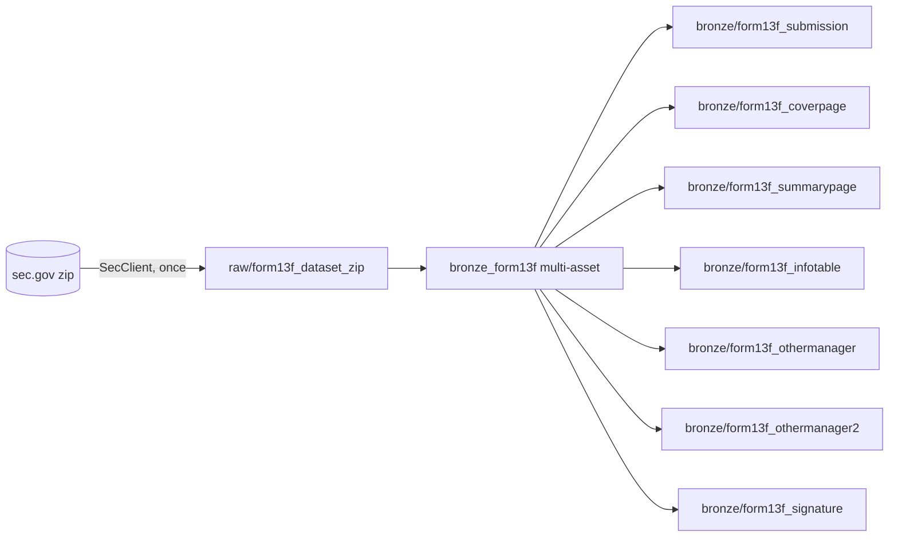

# ADR-002: Bronze partitioning and idempotent loads for the 13F data sets

- Status: Proposed
- Date: 2026-11-06
- Spec: `docs/specs/m1-bronze-ingestion.md`
- Spec decisions it builds on: **Q1** (partition per data set), **Q4** (all-string columns), **Q5**
  (no sensor in M1, #6). Decided by Thanh on 2026-11-06.

## Context

SEC publishes Form 13F data as one zip per filing window: calendar quarters up to 2023
(`2013q2_form13f.zip`), then three-month ranges from 2024 (`01mar2024-31may2024_form13f.zip`).
Each zip holds 7 TSV files, which become 7 Bronze Delta tables. There are 54 zips today and a new
one about every 3 months.

Every load must be safe to re-run, a rerun of one data set must not touch the others (AC6, AC7),
and the whole history must backfill with one command (AC4). Constraints: about 6 h a week, a
homelab with 2 Spark workers, Delta tables on S3-compatible storage (RustFS), and a reviewer who
clones the repo must be able to run it without extra services.

Two terms used below:

- A **partition** (Dagster) is one slice of an asset that can be materialized, re-run and tracked
  on its own. Here one partition = one SEC zip.
- **`replaceWhere`** (Delta) is an overwrite limited to the rows that match a condition: "replace
  only the rows where `_dataset = '2024-03_2024-05'`, keep everything else". It is one atomic
  commit, so readers see the old rows or the new ones, never a mix.

## Options

1. **One partition per SEC data set, static list in code (chosen).** One zip = one partition =
   one `replaceWhere`. The list of zip file names lives in code and is reviewed like any other
   change. Adding a new data set is a one-line PR every 3 months.
2. **One partition per data set, Dagster dynamic partitions.** A discovery step reads the SEC
   page and adds partition keys at run time. Fully automatic, but the partition list lives in the
   Dagster database, not in git: a fresh clone shows zero partitions until discovery has run, and
   tests need a Dagster instance. It also adds a scraper of an HTML page to M1.
3. **Partition by filing quarter or period of report.** Rejected in the spec (Q1): from 2024 a
   filing quarter needs parts of two zips, and late amendments would land in old period
   partitions, so one zip would rewrite many partitions.

On assets, two shapes were considered:

- **One multi-asset for the 7 Bronze tables (chosen)**: one step opens the zip once, writes all
  7 tables and runs their checks. A Dagster *multi-asset* is one function that produces several
  assets.
- **7 separate assets**: nicer lineage in the UI, but each would open and unpack the same zip, or
  they would need a shared staging asset. 7x the work for no gain at this stage.

## Decision

- One Dagster `StaticPartitionsDefinition` for all 13F data set assets, built from a tuple of SEC
  zip file names in code. Keys: `2013q2` ... `2023q4`, then `YYYY-MM_YYYY-MM` for the first and
  last month of the window (`2024-01_2024-02`, `2024-03_2024-05`, `2024-12_2025-02`). These sort
  in time order as plain strings, which a test enforces.
- Two asset definitions: `raw/form13f_dataset_zip` (one asset) and `bronze_form13f` (one
  multi-asset producing the 7 Bronze tables), both on that partition set.
- Bronze tables are written with `replaceWhere _dataset = '<key>'` and physically partitioned by
  `_dataset`. Raw zips are written once and never overwritten.
- Bronze writes are serialized: only one run writes Bronze Delta tables at a time.

## Design

### Partition list

```text
src/sec_lakehouse/sources/form13f/datasets.py
  FORM13F_ZIPS = ("2013q2_form13f.zip", ..., "01jun2026-31aug2026_form13f.zip")
  dataset_key(zip_name) -> "2013q2" | "2026-06_2026-08"
  FORM13F_PARTITIONS = StaticPartitionsDefinition([dataset_key(z) for z in FORM13F_ZIPS])
```

Unit tests: both name formats, the two-month `01jan2024-29feb2024` set, a year-crossing Dec-Feb
set, keys unique and sorted, unknown formats rejected. The zip name is kept, so the URL and raw
path are never rebuilt from the key.

### Assets and dependencies



- `raw/form13f_dataset_zip`: no Spark. Uses the SEC client and storage resources (ADR-003). If
  `raw/form13f_datasets/<key>/<zip name>` exists it makes no HTTP call, re-hashes the stored
  object and reports `downloaded: false`. Metadata: URL, size, SHA-256, download time.
- `bronze_form13f`: a `@multi_asset` with 7 `AssetSpec`s, `deps=[raw]`, `can_subset=False` (the
  7 tables always load together). Steps for one partition:
  1. Open the zip from raw. Fail if any of the 7 members is missing; log unknown extra members.
  2. Check every member's header line against the column list declared in code (lower-cased,
     same order). Any mismatch fails the partition **before anything is written**.
  3. Unpack each member to a staging area with a line number added to each line, then read it
     with Spark (ADR-003 explains how and why).
  4. For each table: split each line on tabs, fail if a line has the wrong number of fields, add
     the 5 metadata columns and write with `replaceWhere`.
  5. Run the asset checks, then delete the partition's staging files.
- Job `form13f_bronze_job` selects both assets. Full backfill, one command (AC4):
  `dagster job backfill -j form13f_bronze_job --all --noprompt` (the daemon runs one run per
  partition). The runbook gives the exact command for dev and UAT.

### Table layout

| Item | Rule |
|---|---|
| Path | `storage.table_path("bronze", "form13f_<table>")`, path-based Delta, no metastore |
| Columns | Declared tuple per table in `sources/form13f/schemas.py`, all `string` (Q4), then `_dataset`, `_source_file`, `_source_line` (long), `_ingested_at` (UTC timestamp), `_run_id` |
| Physical partition | `_dataset` |
| Write | `mode("overwrite").option("replaceWhere", "_dataset = '<key>'")` |
| Keys | As in the spec, unique within one `_dataset` (checked, not enforced by Delta) |

Checked locally with delta-spark 3.3.3: the first `replaceWhere` write creates the table, a
rerun replaces only its own partition, and Delta refuses a write whose rows do not match the
condition (`DELTA_REPLACE_WHERE_MISMATCH`), which protects against a bug writing rows into the
wrong partition.

### How re-runs behave

- **Raw**: written once. The storage API offers `put_new` (fails if the key exists), not
  overwrite or delete. A republished zip is re-landed by hand (runbook, Q6).
- **Bronze rerun of one partition**: one new Delta version per table, same row counts, other
  partitions' files untouched, so their `_ingested_at` and `_run_id` stay the same (AC6, AC7).
- **Failure in the middle**: there is no transaction across the 7 tables. If table 5 fails,
  tables 1 to 4 already hold the new load of that partition. That is safe because the content is
  identical; the rerun repairs it. The run shows as failed, so it is not missed.
- **Amendments** need nothing here: a 13F-HR/A is a row in whichever data set covers its filing
  date. Resolving it is M2's job.

### Concurrency

Delta on S3 is only safe with a **single writer process per table**: plain S3 cannot make two
commits fail cleanly when they race, and the multi-writer fix (a DynamoDB log store) is out of
scope. `dagster.yaml` already allows 2 concurrent runs. So:

- `bronze_form13f` runs in a Dagster concurrency pool `delta_writes` with limit 1
  (`concurrency: pools: default_limit: 1` in `dagster.yaml`). A *pool* is a named slot limit
  across all runs; a step waits until a slot is free.
- The raw asset is not in that pool, so the next zip can download while a Bronze load runs.

### Asset checks

DQ1 to DQ9 are declared as `check_specs` on the multi-asset and evaluated in the same step,
right after the writes, for the partition just loaded (Dagster 1.13 supports partitioned checks
through `AssetCheckSpec(partitions_def=...)`). Block-level checks use `blocking=True` and
severity ERROR, so a failure marks the run failed and blocks downstream assets. Warn-level checks
use severity WARN and record their counts as metadata. DQ5 compares the Delta row count with the
line count taken while unpacking. DQ7 is the only check that reads other partitions.

### New data sets (Q5)

A new SEC zip appears as a one-line PR to `FORM13F_ZIPS`. Until then it is silently missing, so
the runbook includes a quarterly "check the SEC page" step. If Thanh keeps the sensor (Q5) and
wants AC14 as written (the sensor requests a run for the new partition), the partitions must
become dynamic (option 2). The keys keep the same format, so no data moves; estimate +2 h on top
of the sensor's 3 h.

## Consequences

- Adding a data set needs a code change and a deploy, which is a small cost every 3 months and
  makes the partition list reviewable and reproducible from git.
- Bronze loads run one at a time, so the backfill is bounded by one Spark application at a time
  on the 2 workers. That is fine for 54 partitions but is the main lever if the backfill is slow.
- A partition is not "the holdings for quarter X". Anyone querying Bronze must filter or group by
  `submission.periodofreport` themselves; Silver fixes this.
- One multi-asset means one step in the UI for 7 tables; a schema problem in one fails all 7.

## Risks

- **SEC renames a file or changes the name format again.** Shows up as `dataset_key` raising an
  error in a unit test when the new name is added. Fix: extend the parser.
- **A header changes between data sets** (a column added). Shows up as a clear header-mismatch
  failure for that partition. Fix: version the declared schema per data set range, explicitly.
- **Concurrent writes if the pool limit is missing** (for example a fresh dev instance without
  the `dagster.yaml` setting). Shows up as a `ConcurrentAppendException` or, worse, a lost commit
  on S3. Mitigation: Compose (dev and UAT) uses `docker/dagster.yaml`, which carries the setting,
  and the runbook checks `dagster instance concurrency get` before a backfill. `uv run dagster
  dev` writes to local disk, where a racing Delta commit fails cleanly instead of being lost.
