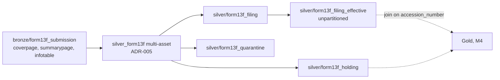

# ADR-004: Resolving 13F amendments into an effective report in Silver

- Status: Proposed (awaiting Checkpoint 1)
- Date: 2026-11-17
- Spec: `docs/specs/m2-silver.md` (draft)
- Depends on spec answers: designed on the spec's recommended answers, which Thanh has not
  decided yet.
  - **Q2 = B** (a small filing-level table in Silver). With **A**, the table and its checks move
    to M4 Gold unchanged and S3 shrinks to the fixtures and a pure function. With **C**, a
    holding-level table is added on top of this one, partitioned like `silver.form13f_holding`
    and refreshed per touched period (about +4 h, and every Silver rerun must keep it in step).
  - **Q7 = A** (notices never change the effective set). With **B**, a `13F-NT/A` with
    `RESTATEMENT` becomes a base candidate with no holdings, so a later notice empties the
    filer's period. That is one extra line in the classification table below.
  - Q6 (latest copy wins) only matters through `silver.form13f_filing`, which this ADR reads.

## Context

A 13F filer can amend a report with a `13F-HR/A`. The amendment says either `RESTATEMENT` (it
replaces the whole earlier report) or `NEW HOLDINGS` (its lines are added to the earlier report).
Amendments are their own accession numbers, can arrive years after the period, and land in
whichever SEC data set covers their filing date. The data sets do not say which filing an
amendment amends: we only have the filer `cik`, the `period_of_report`, the filing date, an
`amendment_no` (reliability **unverified**) and the amendment type.

Gold needs "the holdings of filer F for quarter Q as finally reported" without every query
re-implementing that logic. Constraints: about 6 h a week (S3 has 5 h), 2 Spark workers, and a
reviewer who clones the repo must be able to run the tests on the fixtures alone. Filings are
small (hundreds of thousands of rows in total); holdings are large (about 150 to 200 M rows,
**unverified**).

Terms used below:

- An **asset check** is a Dagster test attached to a table, run with the write, whose result is
  stored and shown in the UI. A **block** check fails the step so nothing downstream runs; a
  **warn** check only records a number.
- **Idempotent** means running the same step twice on the same input leaves the same result as
  running it once.
- A Delta **`MERGE`** compares a set of new rows with a table on a key and, in one atomic commit,
  updates the rows that match, inserts the ones that don't, and optionally deletes some.

## Options

1. **A filing-level role table in Silver, recomputed in full every run (chosen, Q2 B).** One row
   per filing saying whether it is the BASE of its `(cik, period_of_report)`, an ADDITION on top
   of it, SUPERSEDED, or outside the set. Gold gets the effective holdings with one join. The
   table is small, so recomputing all of it is cheap and avoids tracking which groups a run
   touched.
2. **Roles computed in Gold at query time (Q2 A).** Nothing extra in Silver, but the amendment
   rule, a named M2 goal, would not be tested until M4, and every Gold query repeats it.
3. **A holding-level effective table (Q2 C).** Simplest for Gold, but it copies most of the
   holding rows and must follow every Silver rerun of every data set.

On the algorithm, two shapes were considered:

- **Order the filings of a group and pick the latest base (chosen).** Only needs the columns
  the data sets have, and one Spark window per group.
- **Chain each amendment to the filing it amends** (amendment *n* points to *n - 1*). Closer to
  the legal meaning, but the data sets carry no "amends accession X" field, and `amendment_no`
  is unverified, so the chain would be guessed anyway.

## Decision

- `silver.form13f_filing_effective` is a separate, unpartitioned Dagster asset that depends on
  `silver/form13f_filing`. It is part of `form13f_silver_job`, so every Silver partition run
  recomputes it after the filing table is written (Dagster 1.13 runs an unpartitioned asset
  inside a partitioned run; checked locally).
- Roles come from ordering the holdings-bearing filings of each `(cik, period_of_report)` by
  `(filing_date, amendment_no or 0, accession_number)`. The latest original or restatement is the
  BASE; `NEW HOLDINGS` amendments after it are ADDITIONs; the rest are SUPERSEDED.
- The table is recomputed from the whole of `silver.form13f_filing` and written with a `MERGE` on
  `accession_number` that only touches rows whose content changed (see "Writing" for why this
  is not the plain overwrite the spec describes).

## Design

### Assets and dependencies



The effective step reads only `silver.form13f_filing` (small, read whole) and runs in the
`delta_writes` pool like every Delta writer (ADR-005). It makes no HTTP request.

### Classification

| `submission_type` | `amendment_type` | Kind |
|---|---|---|
| `13F-HR` | any (normally null; SDQ10 counts it when set) | base candidate |
| `13F-HR/A` | `RESTATEMENT` | base candidate |
| `13F-HR/A` | `NEW HOLDINGS` | addition candidate |
| `13F-HR/A` | null (missing, or an unknown value stored as null) | `UNCLASSIFIED` |
| `13F-NT`, `13F-NT/A` | any | `NOT_HOLDINGS` (Q7 A) |

Other submission types never reach Silver (`BAD_SUBMISSION_TYPE` quarantine, ADR-005).

### Roles

For each filing, `ord = struct(filing_date, coalesce(amendment_no, 0), accession_number)`. Spark
compares structs field by field, so this is the spec's ordering with the accession number as
the last tie-break, which makes the order total and the result deterministic. Over the window
`partitionBy(cik, period_of_report)` (no ordering, whole group):

```python
base_ord = F.max(F.when(kind == "BASE_CANDIDATE", ord)).over(group)  # null if none
```

| Kind | Condition | `effective_role` | Links |
|---|---|---|---|
| base candidate | `ord = base_ord` | `BASE` | `base_accession_number` = itself |
| base candidate | `ord < base_ord` | `SUPERSEDED` | `superseded_by_accession_number` = base |
| addition candidate | `base_ord` is null | `ADDITION`, `base_missing = true` | none |
| addition candidate | `ord > base_ord` | `ADDITION` | `base_accession_number` = base |
| addition candidate | `ord < base_ord` | `SUPERSEDED` | `superseded_by_accession_number` = base |
| `UNCLASSIFIED`, `NOT_HOLDINGS` | always | same as kind | none |

Everything is built-in functions (`when`, `max` over a window, `struct` comparison, a self-join
for the base accession); no UDF, nothing collected. `base_missing` is false on every other row.

Two consequences worth stating: a second plain `13F-HR` for the same period (some filers refile
instead of amending) replaces the first, and a `NEW HOLDINGS` amendment filed before a later
restatement is dropped, because the restatement is a full report.

### Table layout

| Item | Rule |
|---|---|
| Path | `storage.table_path("silver", "form13f_filing_effective")` |
| Key | `accession_number`, one row per row of `silver.form13f_filing` |
| Columns | As in the spec, plus the common `_dataset` and `_source_line` copied from the filing row, and `_silver_processed_at`, `_silver_run_id` of the run that last changed the row |
| Physical partition | none (small table, and one group spans many data sets) |
| Schema | Declared and created up front like every Silver table (ADR-005); no schema merging |

### Writing, re-runs and order

- **Writing.** The new roles are compared with the table and written with one `MERGE` on
  `accession_number`: update when any business column differs (null-safe `<=>` on each column),
  insert new filings, delete filings that left `silver.form13f_filing`
  (`whenNotMatchedBySourceDelete`). The spec says "full overwrite"; a `MERGE` gives the same
  content but keeps `_silver_run_id` on rows that did not change, which AC7 asks for. On a table
  this small, the full scan that the not-matched-by-source clause causes (ADR-005) does not
  matter.
- **Idempotent.** The roles are a function of `silver.form13f_filing` alone. Running the step
  twice on the same filing table changes no row the second time.
- **Out-of-order backfill.** Whatever order the data sets run in, the last Delta write of a
  backfill is an effective step: each run ends with one, and the `delta_writes` pool runs one
  step at a time, so the last effective step reads the final filing table. Its result therefore
  equals the result of a single run on the final filing table (AC8).
- **A new data set changes old rows.** A restatement filed in 2026 for 2022 Q3 turns the original
  of that period into `SUPERSEDED`. That row gets the new run's id. This is intended.
- **Failure.** If the Silver step fails, Dagster does not run the effective step in that run, so
  the table keeps its previous, consistent state.

### How Gold will use it

```sql
SELECT h.*
FROM silver.form13f_holding h
JOIN silver.form13f_filing_effective e ON e.accession_number = h.accession_number
WHERE h.period_of_report = DATE '2024-12-31'      -- prunes to one Delta partition (Q1 B)
  AND e.effective_role IN ('BASE', 'ADDITION')
```

A filing marked incomplete (`is_confidential_omitted`) or with `base_missing` stays in the
result; Gold decides how to flag it.

### Asset checks

| Check | Rule | Level |
|---|---|---|
| SDQ1 | table has rows | block |
| SDQ2 | `accession_number` not null and unique | block |
| SDQ8a | at most one `BASE` per `(cik, period_of_report)`; exactly one where the group has a base candidate | block |
| SDQ8b | every `ADDITION` with a base has `ord` greater than its base's `ord` | block |
| SDQ8c | completeness: same accession set as `silver.form13f_filing` (anti-joins both ways are empty) | block |
| SDQ8 counts | `base_missing` rows, `UNCLASSIFIED` rows, groups with more than one `13F-HR`, rows per role, and the Q7 count: groups with a `13F-NT/A` `RESTATEMENT` ordered after their BASE | warn (metadata) |

All are single-row aggregates over a table of hundreds of thousands of rows.

### Tests

Real fixtures: the `2022q4` restatement `0001085146-22-003667` is `BASE`; the `2013q2` notice
`0000950123-13-003781` (`13F-NT/A`, `NEW HOLDINGS`) is `NOT_HOLDINGS`. Hand-made filing rows
(marked in the fixtures README): original then restatement; original then `NEW HOLDINGS`;
`NEW HOLDINGS` then a later restatement (superseded); same-day amendments ordered by
`amendment_no`, then by accession; an addition with no base (`base_missing`); an unknown
amendment type (`UNCLASSIFIED`); two originals; a restatement notice after a base (Q7 count = 1).
Plus: the same input in shuffled row order gives the same table, and a second run updates 0 rows.

## Consequences

- Gold must join holdings to this table to get effective holdings; nothing in Silver hands it
  out ready-made (Q2 B by design).
- A backfill recomputes the table once per data set (54 times). Each pass reads the filing table
  and starts a Spark application, so this adds minutes, not hours, to the backfill.
- The resolution is only as good as the ordering inputs: the rule trusts `filing_date` first and
  `amendment_no` second, and cannot know which filing an amendment meant.

## Risks

- **A quarantined filing silently drops out of its group.** If a restatement is quarantined (bad
  date), the earlier original becomes BASE with no warning in this table. Shows up as filing-level
  quarantine counts (SDQ6). Mitigation: S3 adds a warn count of groups whose `cik` and period
  strings match a quarantined submission's `raw_row`.
- **More `amendment_type` values than the two seen.** They land as `UNCLASSIFIED` and take no part
  in the set. Shows up in the SDQ8 and SDQ10 counts after the backfill; fix the mapping in a PR.
- **`amendment_no` unreliable on same-day amendments.** The wrong one becomes BASE. Rare (needs
  two amendments on one day); S3 profiles same-day groups on real data.
- **A filer amends under a different CIK** (successor entity, filing agent). The amendment forms
  its own group, typically `base_missing`. Shows up in the `base_missing` count; resolving it
  needs manager entity resolution (M3).

## Open questions (for Checkpoint 1)

1. **SDQ8 and AC11 ask for exactly one BASE for every group with a `13F-HR` or `13F-HR/A`.** A
   group with only `base_missing` additions or only `UNCLASSIFIED` amendments has none, by the
   spec's own rules. Recommendation: "exactly one BASE where the group has a base candidate",
   with the other groups counted (SDQ8a and counts above). AC11 needs the same wording.
2. **The Q7 warning count has no SDQ number.** Recommendation: record it as metadata on SDQ8, as
   above.
3. **"Full overwrite" vs `MERGE` for this table.** Recommendation: `MERGE`, so AC7 holds for this
   table too (see "Writing").
