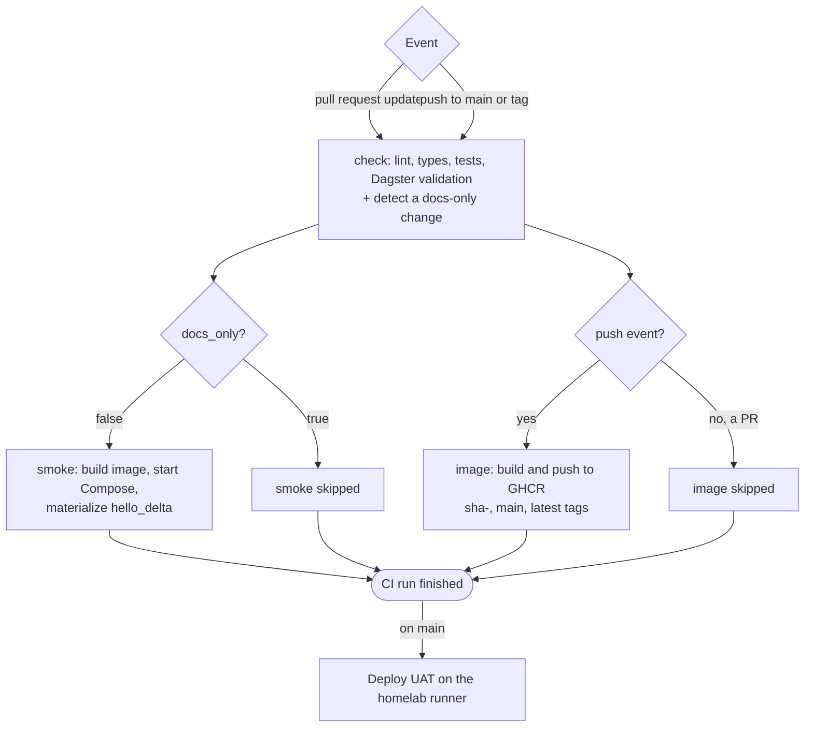
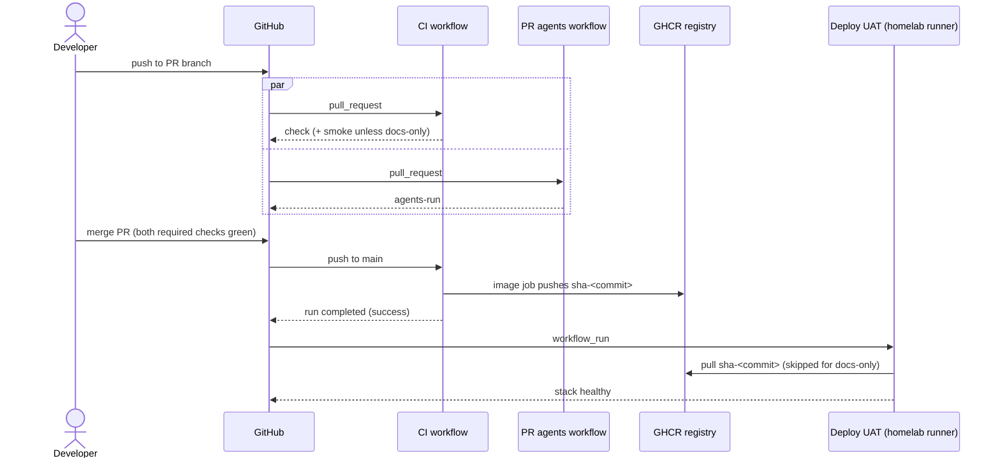

# How CI, the PR agents check and the UAT deploy fit together

A walkthrough of the three GitHub Actions workflows in `.github/workflows/`, written for someone
who has not used GitHub Actions much. It explains what runs when, why you see several runs for one
change, and which runs were cut in November 2026 because they did nothing useful.

## The big picture

GitHub Actions starts a **workflow run** when an **event** happens (a push, a pull request
update, another workflow finishing). Each run has one or more **jobs**, and each job runs on a
fresh machine called a **runner**. The repo has three workflows:

| Workflow | File | Starts on | Jobs |
| --- | --- | --- | --- |
| CI | `ci.yml` | a pull request update, a push to `main`, a `v*` tag | `check`, `smoke`, `image` |
| PR agents | `pr-agents.yml` | a pull request opened, edited, pushed to or reopened | `agents-run` |
| Deploy UAT | `deploy-uat.yml` | CI finishing on `main`, or a manual click | `deploy` |

So a normal change produces runs in this order:

1. Every push to a PR branch starts **CI** and **PR agents** (two runs).
2. Merging the PR pushes a commit to `main`, which starts **CI** again on the merged code.
3. When that CI run finishes, **Deploy UAT** starts. GitHub starts it for *every* finished CI run
   on `main`, even a cancelled one. The job's `if:` then skips it, which is why some Deploy UAT
   runs show as "skipped". They cost no runner time.

`check` and `agents-run` are **required checks**: the branch ruleset on `main` won't let a PR merge
until both report success. A job that is skipped by its `if:` reports "skipped", and GitHub
counts that as passing. That matters below.

## What changed and why

The run history from 5 to 17 November 2026 had 69 runs: 41 CI (26 on PRs, 15 on `main`), 15 PR
agents and 13 Deploy UAT. Two kinds of work in there did nothing:

- **The image was built twice in every CI run.** `smoke` builds the app image to start the
  Compose stack, and `image` built the same Dockerfile again. On a PR, `image` didn't even push
  it anywhere; it built it and threw it away. Now `image` runs only on pushes to `main` and tags,
  where it publishes the image UAT pulls.
- **Docs-only PRs ran the whole Docker stack.** Three of the fifteen PRs (#3, #4, #18) only
  changed Markdown, yet each push started the Compose smoke test and the image build. Markdown
  can't change the image, so `smoke` is now skipped when every changed file is under `docs/` or
  ends in `.md`.

What was kept on purpose:

- **`check` always runs, docs-only or not.** It is required, and ruff also lints the Python code
  blocks inside Markdown (PR #18 failed `check` on an ADR's code block), so docs can break it.
- **CI on `main` after a merge.** It tests the merged result, which can differ from the PR branch,
  and it is the run that publishes the image the deploy needs.
- **`image` on docs-only pushes to `main`.** A manual redeploy pins `sha-<commit>`, so every `main`
  commit needs its image.
- **PR agents re-running when the PR body is edited.** That is how a fixed description turns the
  check green. Skipping it on title-only edits looks tempting, but a skipped run would *replace*
  a failing `agents-run` with "skipped", which counts as a pass. So it stays as it is; it takes
  about ten seconds.
- **Concurrency groups**, already in all three files: a newer push to the same PR or to `main`
  cancels the older CI run, and deploys queue one at a time instead of cancelling each other.

## One CI run, step by step

## From PR to UAT

## A tour of the code

In `ci.yml`:

1. **`check` checks out the full history** (`fetch-depth: 0`), because the docs-only test needs
   the base commit to diff against. `persist-credentials: false` keeps the GitHub token out of
   the checkout, since this job never pushes.
2. **"Detect a docs-only change"** works out the base and head commits: the PR's base and head
   on a pull request, or `github.event.before` and the new commit on a push. It lists the changed
   files with `git diff --name-only --no-renames base...head` and sets `docs_only=true` only if
   that list is non-empty and every file matches `^docs/|\.md$`. Anything it can't work out (a
   tag, a brand-new branch whose `before` is all zeros, a missing base) counts as a code change,
   so the Docker jobs run. The SHAs come in through `env:`, not pasted into the script.
3. The step writes `docs_only` to `$GITHUB_OUTPUT`, and the job exposes it as
   `outputs.docs_only` so later jobs can read it as `needs.check.outputs.docs_only`.
4. **`smoke`** has `if: needs.check.outputs.docs_only != 'true'`. Comparing with `!= 'true'`
   means that if the output were ever missing, `smoke` would still run.
5. **`image`** has `if: github.event_name == 'push'` and now always pushes, so the GHCR login
   step no longer needs its own condition.

`deploy-uat.yml` and `pr-agents.yml` did not change. The deploy already skips the restart for the
same docs-only rule, using its own `git diff` on the server.

## Safety checks

- **Required checks still report.** `check` runs on every PR. `smoke` and `image` are not
  required, so skipping them can't leave a PR stuck waiting.
- **The deploy still has its image.** `image` runs on every push to `main`, docs-only included,
  and Deploy UAT still waits for the whole CI run to succeed.
- **Fail toward running more.** Every unclear case in the docs-only test runs the Docker jobs.
- **No new third-party actions.** The path test is a few lines of shell instead of a
  path-filter action, so nothing new runs with access to the repo.
- **The self-hosted runner is untouched.** No `pull_request` job targets `[self-hosted, uat]`.

## How it was tested

- The docs-only step was run locally against real history: PR #18's commits give
  `docs_only=true`, PR #19's give `false`, an all-zeros base gives `false` and a tag gives `false`.
- `actionlint` passes on `ci.yml` and `pr-agents.yml`.
- The PR that made this change ran CI itself. A Markdown-only push to a PR is the way to see
  `smoke` skipped while `check` still runs.

## Glossary

- **Workflow / run / job / step**: a YAML file; one execution of it; a unit of work on one runner;
  one command or action inside a job.
- **Runner**: the machine a job runs on. GitHub hosts `ubuntu-latest`; the homelab runs a
  **self-hosted** runner for the UAT deploy.
- **Required check**: a job name the branch rules on `main` insist reports success before a merge.
- **`needs` / job outputs**: `needs: check` makes a job wait for `check` and lets it read the
  values `check` wrote to `$GITHUB_OUTPUT`.
- **Concurrency group**: runs that share a group name; with `cancel-in-progress: true` a new run
  cancels the older one.
- **`workflow_run`**: an event fired when another workflow finishes, whatever its result.
- **GHCR**: GitHub Container Registry, where the app image is published.
