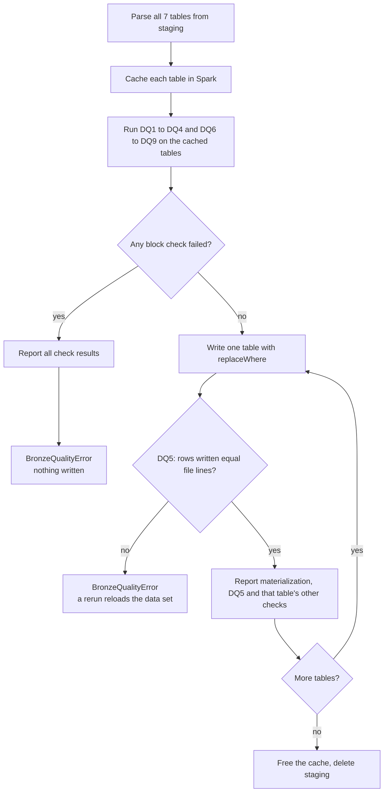
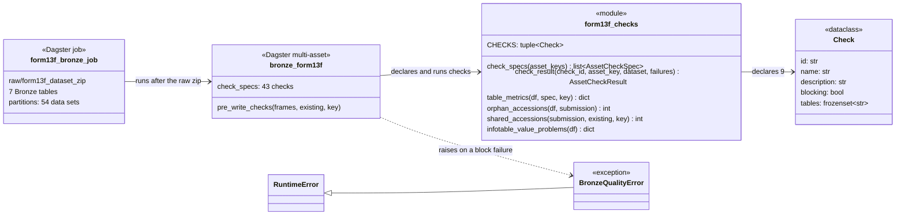
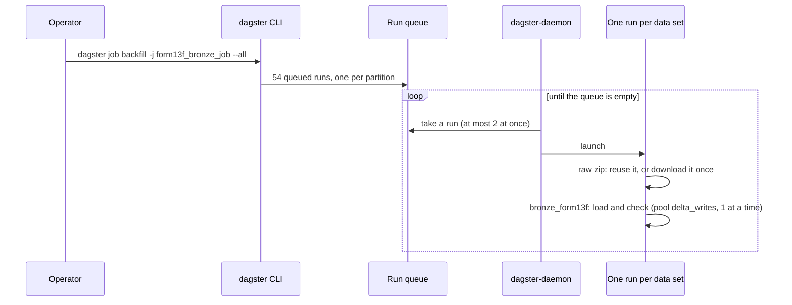

# Bronze checks and the backfill job

A walkthrough of the data quality checks DQ1 to DQ9 and the `form13f_bronze_job` backfill job,
written for someone new to Dagster. It builds on
[How the Bronze load works](form13f-bronze-walkthrough.md). Rules: the
[M1 spec](../specs/m1-bronze-ingestion.md), section "Data quality rules". How to run it:
[runbook](../runbooks/form13f-bronze.md).

## The big picture

Loading a data set is not enough: we also want proof that what landed is sound. Dagster has a
feature for this, **asset checks**: named tests attached to an asset, whose pass or fail shows up
next to the asset in the UI, with numbers attached.

This slice adds two things:

- **Nine checks (DQ1 to DQ9)** on the 7 Bronze tables, 43 check results per data set in all.
- **One job, `form13f_bronze_job`**, that downloads a data set and loads it. A backfill of that job
  over all 54 partitions is the full M1 load, started with one command.

Checks come in two levels:

- **Block**: the data set is wrong and must not be loaded. The run fails and Bronze is left as it
  was.
- **Warn**: something worth knowing, such as a holding whose filing is missing from SUBMISSION.
  The count is recorded and the run carries on.

| ID | Rule | Tables | Level |
| --- | --- | --- | --- |
| DQ1 | At least one row | submission, coverpage, summarypage, signature, infotable | block |
| DQ2 | Row count recorded (may be 0) | othermanager, othermanager2 | warn |
| DQ3 | Key columns not null or empty | all 7 | block |
| DQ4 | Key unique within the data set | all 7 | block |
| DQ5 | Rows written equal the data lines in the file | all 7 | block |
| DQ6 | Accession numbers missing from SUBMISSION | all but submission | warn |
| DQ7 | Accession numbers also in another data set | submission | warn |
| DQ8 | `cusip` not 9 characters; `value`, `sshprnamt` not whole numbers | infotable | warn |
| DQ9 | Metadata columns filled; `_dataset` equals the partition | all 7 | block |

## Where the checks run

In Dagster, a check can be a separate function or can run inside the asset. Here they run inside
`bronze_form13f`, because the asset already holds the parsed tables in memory. Running them before
the write is what lets a failing block check leave Bronze untouched.



DQ5 is the only check that needs the written table, so it runs after each write. The others look
only at the parsed data, plus, for DQ7, the Bronze SUBMISSION table as it stood before this run.

## The building blocks



- `src/sec_lakehouse/assets/form13f_checks.py` lists the 9 checks once, in `CHECKS`.
  `check_specs()` turns that list into Dagster `AssetCheckSpec`s, one per check and table, and
  `check_result()` turns a count of failures into an `AssetCheckResult` (0 failures = passed). Block
  checks report with severity ERROR, warn checks with WARN. Each result also carries the data set
  key, because Dagster keeps check history per asset, not per partition.
- The metric functions each run **one Spark aggregation** and bring back a single row, so nothing
  big ever reaches the driver.
- `src/sec_lakehouse/jobs.py` defines `form13f_bronze_job` over the raw asset and the 7 Bronze
  assets, partitioned like them.

## Walking through the code

1. **Declare.** `@multi_asset(..., check_specs=check_specs(BRONZE_KEYS))` tells Dagster which checks
   exist. The UI lists them under each Bronze asset even before the first run.
2. **Cache.** After parsing, each table is `persist`ed in Spark memory (spilling to disk if needed),
   because the checks and the write read it several times. The `finally` block frees the cache
   even when the run fails.
3. **Measure.** `pre_write_checks()` loops over the 7 tables. `table_metrics()` counts rows, rows
   with a missing key and rows with bad metadata in one pass:

   ```python
   df.agg(
       F.count(F.lit(1)).alias("rows"),
       F.sum(F.when(key_missing, 1).otherwise(0)).alias("key_missing"),
       F.sum(F.when(meta_bad, 1).otherwise(0)).alias("meta_bad"),
   ).first()
   ```

   Duplicate keys need a second pass: group by the key columns and count the groups with more than
   one row. DQ6 is a `left_anti` join (accession numbers with no match in SUBMISSION), DQ7 an inner
   join against the other data sets already in Bronze.
4. **Decide.** If any ERROR-level result failed, the asset yields every result, so the UI shows
   them all, then raises `BronzeQualityError` naming each failed check and table. Nothing has been
   written yet.
5. **Write and report.** Otherwise each table is written as before. After each write the asset
   yields its `MaterializeResult`, then DQ5, then that table's other results. Dagster ties a check
   result to the latest materialization of its asset, which is why results come after it.

## The backfill job

A **job** is a named set of assets that run together. A **backfill** launches one run of a
partitioned job per partition.



The limits live in `docker/dagster.yaml`: 2 runs at once, and the pool `delta_writes` lets only one
Bronze load write at a time (Delta on S3 is safe with one writer per table, ADR-002). The raw
download has no pool, so one run can download while another loads. The command was tried against
a scratch Dagster instance: it queued exactly 54 runs, from `2013q2` to `2026-06_2026-08`.

## Tests

| Test | What it proves |
| --- | --- |
| `test_checks_pass_and_warn_counts_are_recorded` | All 43 checks report; block checks pass on good data; DQ6 counts an orphan holding, DQ8 counts bad values, DQ7 counts accession numbers repeated in a second data set. Warn failures do not fail the run. |
| `test_real_sample_loads_with_block_checks_passing` | Cuts of three real SEC zips (2013q2, 2022q4, 2026-06_2026-08, in `tests/fixtures/form13f/`) unpack against the declared columns and load with every block check passing. |
| `test_blocking_check_fails_the_run_and_writes_nothing` | A duplicate key (DQ4), an empty INFOTABLE (DQ1) and a blank key (DQ3) each fail the run, name the check in the error, and leave no Bronze table behind. |

The test zips now give row *i* of every table the same accession number, so keys are unique and
the tables join the way real filings do (`tests/form13f_zips.py`).

## Glossary

| Term | Meaning |
| --- | --- |
| Asset check | A named test attached to an asset; its result shows in the Dagster UI with numbers. |
| Severity | ERROR for block checks, WARN for warn checks. |
| `AssetCheckSpec` | The declaration of a check: its name, the asset it belongs to, whether it blocks. |
| `AssetCheckResult` | One evaluation of a check: passed or not, plus metadata such as counts. |
| Job | A named set of assets that run together in one run. |
| Backfill | One run of a partitioned job for each of many partitions. |
| Pool | A Dagster limit on how many steps of one kind run at once. |
| `persist` | Keep a Spark DataFrame's data in memory (or on disk) so later steps don't recompute it. |
| Left anti join | The rows of the left table that have no match in the right table. |
