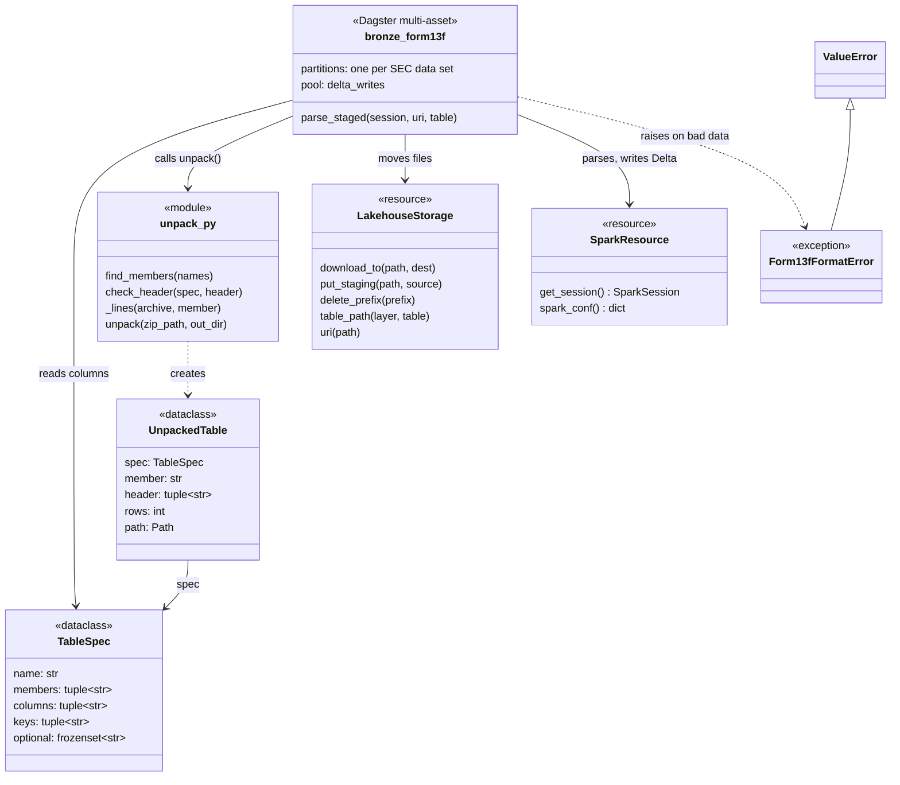
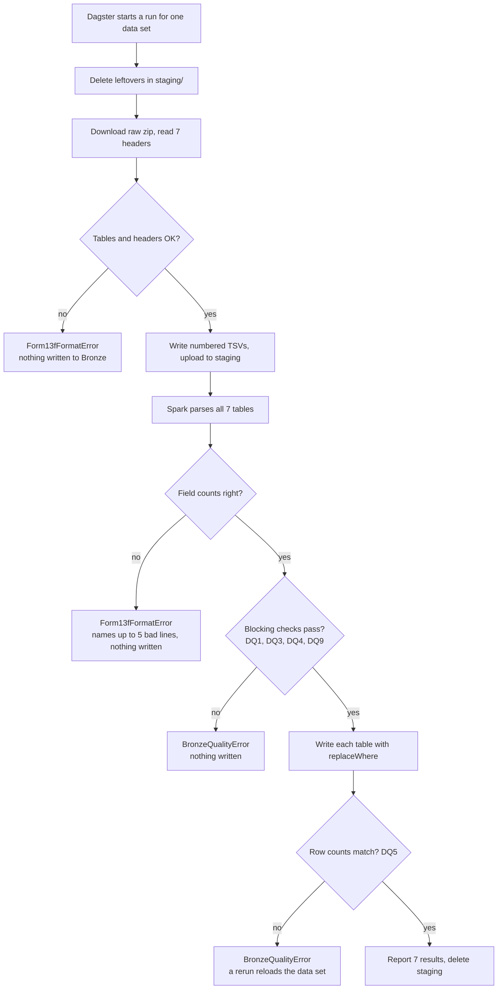
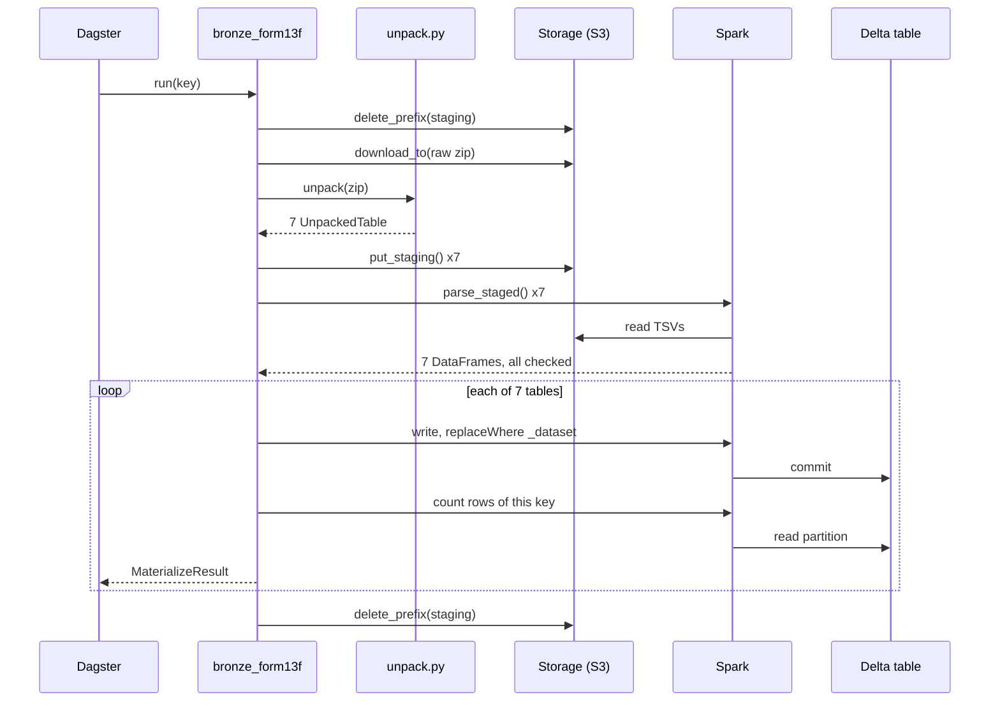

# How the Bronze load works (13F data sets)

A walkthrough of the `bronze_form13f` asset, written for someone new to Dagster, Spark and
Delta Lake. It explains the code added in PR #14. Related decisions: [ADR-002](../adr/002-bronze-partitioning-and-idempotent-loads.md),
[ADR-003](../adr/003-sec-http-client-and-raw-landing.md); data contract: [M1 spec](../specs/m1-bronze-ingestion.md).

## The big picture

The asset takes one SEC 13F data-set zip that is already stored in the raw layer and turns it
into 7 Delta tables in the Bronze layer, one row per line of the source files.

- **What SEC gives us.** Each quarter (since 2024, each 3-month window) SEC publishes one zip.
  Inside are 7 tab-separated text files, one per table: `SUBMISSION`, `COVERPAGE`,
  `OTHERMANAGER`, `SIGNATURE`, `SUMMARYPAGE`, `OTHERMANAGER2` and `INFOTABLE` (the holdings).
- **What Bronze means.** Bronze is the first queryable copy of the data. Values are not changed:
  every column is kept as a string, exactly as SEC wrote it. Cleaning and typing come later, in
  Silver (M2).
- **What we add to each row.** Five metadata columns say where the row came from: `_dataset`
  (which zip, e.g. `2013q2`), `_source_file`, `_source_line`, `_ingested_at` (UTC) and `_run_id`
  (the Dagster run).
- **One partition per data set.** Each zip is a Dagster partition, and each Bronze table is a
  Delta table split into folders by `_dataset`. Loading `2024-03_2024-05` again replaces only
  that folder's rows.

The raw-zip asset (PR #9) stored the zip in raw. This asset reads it from there, so SEC is never
contacted here.

## The building blocks

The asset owns the run. Everything else is a small piece it calls, so each piece can be tested
on its own.



`TableSpec` and `UnpackedTable` are plain data holders: one describes what a table should look
like, the other describes what was actually found in this zip. The two resources are passed in by
Dagster, so tests can swap them for local versions.

## One run, start to finish

A run loads exactly one data set. It does all of its checking before it writes, so a bad zip
leaves Bronze untouched.



The first three checks run before any write, so a failure there changes nothing. The data
quality checks are explained in [Bronze checks and backfill](form13f-bronze-checks-and-backfill.md). The last check
runs after each write. If it ever fails, rerunning the data set replaces its rows again, because
`replaceWhere` makes every run start from a clean partition.

## Who talks to whom

The asset is the conductor: it calls storage and the unpacker in plain Python, then hands the
heavy work to Spark.



Spark reads the staged files from storage, not from the driver's disk: in UAT the Spark workers
run in other containers and cannot see the driver's temp folder. That is why the TSVs are
uploaded to `staging/` first.

## Walking through the code

The asset function `bronze_form13f` in `src/sec_lakehouse/assets/form13f_bronze.py` does the job
in five steps.

1. **Work out names.** `context.partition_key` is the data set being loaded, e.g. `2013q2`. From
   it come the raw zip path, the staging folder `staging/form13f/2013q2` and a UTC timestamp for
   `_ingested_at`.
2. **Clean up and unpack on the driver.** `storage.delete_prefix(staging)` removes leftovers from
   a failed run. The zip is downloaded to a temp folder and `unpack()` turns it into 7 TSV files.
   Each staged line is `<line number>\t<original line>`:

   ```text
   2	0001234567-24-000001	31-MAR-2024	13F-HR	1234567	31-MAR-2024
   ```

   The `2` is the line number in the original file; the header was line 1. `put_staging()`
   uploads each file to object storage so the Spark workers can read it.
3. **Parse all 7 tables before writing any.** `parse_staged()` uses Spark's built-in
   `split(value, "\t", -1)` on every line. The `-1` keeps empty trailing fields, so an empty
   value stays an empty string. If any line has the wrong number of fields, the run fails and
   names up to 5 line numbers. Columns are picked by the header's position, so a column SEC moves
   is still found by name.
4. **Write each table with `replaceWhere`.**

   ```python
   df.write.format("delta").mode("overwrite")
     .option("replaceWhere", f"_dataset = '{key}'")
     .partitionBy("_dataset").save(path)
   ```

   `overwrite` plus `replaceWhere` means: delete the rows where `_dataset` is this key, then add
   the new rows, in one Delta commit. Other data sets in the same table are not touched.
5. **Check and report.** The asset reads the table back, counts this partition's rows and
   compares the count with the number of data lines in the file. It then yields a
   `MaterializeResult` per table, which is what the Dagster UI shows: path, row count, source
   file and any missing optional columns. Finally the staging folder is deleted.

Three small modules support it:

| File | What it does |
| --- | --- |
| `sources/form13f/schemas.py` | Declares the 7 tables: the member file names accepted, the columns in readme order, the key columns, and which columns may be missing (`figi` in older zips). |
| `sources/form13f/unpack.py` | Finds each table in the zip, checks every header against `schemas.py`, then streams the lines into numbered TSV files. Plain Python, no Spark. |
| `resources/storage.py` | `download_to`, `put_staging` and `delete_prefix`, which work on local disk and on S3 (RustFS). Staging writes are only allowed under `staging/`. |

## Safety nets

If the data is not what we expect, the run stops with a clear message rather than load something
wrong.

| Check | Where | Why it matters |
| --- | --- | --- |
| A table is missing, or appears twice in the zip | `find_members()` | We cannot guess which copy is right. |
| Header columns differ from `schemas.py` | `check_header()` | SEC renaming a column must be a deliberate code change, never a silent null column. |
| A line is not valid UTF-8 | `_lines()` | The error names the file and line number. |
| A line has too many or too few fields | `parse_staged()` | Usually a tab or line break inside a value. Up to 5 line numbers are reported. |
| Rows written differ from lines in the file (DQ5) | after each write | Proves nothing was dropped between the file and Delta. |

Three design choices keep reruns safe:

- **Idempotent.** `replaceWhere` makes loading the same data set twice give the same result as
  loading it once.
- **All or nothing across tables.** All 7 tables are parsed and checked before the first write.
  A bad row in `INFOTABLE` cannot leave `SUBMISSION` already replaced.
- **One writer at a time.** Delta on S3 is only safe with one writer per table (ADR-002). The
  asset sits in the Dagster pool `delta_writes`, and `docker/dagster.yaml` limits that pool to 1
  running step. Downloads have no pool, so a zip can still download while Bronze loads.

**Why unpack on the driver?** A zip cannot be split across Spark workers. Streaming it line by
line in Python keeps memory flat, and then Spark does the heavy parsing in parallel (ADR-003).

## Tests

Tests build small fake zips in code (`tests/form13f_zips.py`), so they need no network. Run them
with `uv run pytest`.

| Test file | What it proves |
| --- | --- |
| `tests/test_form13f_unpack.py` | Tables are found by name, both `SIGNATURE` and `SIGNATUREBLOCK` are accepted, duplicates and bad headers fail, Windows line endings and a UTF-8 BOM are handled. |
| `tests/test_form13f_bronze_asset.py` | Runs the real asset with Spark: all 7 tables load as strings, a rerun replaces only its own partition, a missing `figi` loads as null, values survive unchanged, a bad later table leaves the partition as it was, `_ingested_at` is UTC on a Toronto-time machine. |
| `tests/test_storage.py` | Staging upload, overwrite and prefix delete on local disk and on a fake S3, including that a sibling prefix such as `2013q2x` is kept. |

## Glossary

| Term | Meaning |
| --- | --- |
| Asset | Something Dagster produces and tracks, here a Bronze table. |
| Multi-asset | One function that produces several assets in one run, here all 7 tables. |
| Partition | One slice of an asset that can be run on its own, here one SEC data set. |
| Resource | A shared helper Dagster passes in, here `SparkResource` and `LakehouseStorage`. |
| Pool | A Dagster limit on how many steps of one kind run at once. |
| Delta table | Parquet files plus a transaction log, which gives safe overwrites and history. |
| `replaceWhere` | A Delta write option: overwrite only the rows that match a condition. |
| Driver | The Python process that starts Spark jobs; the workers do the parallel work. |
| Staging | A short-lived folder in object storage that both the driver and the workers can read. |
