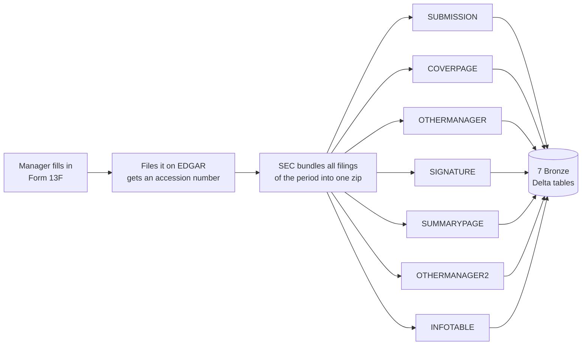
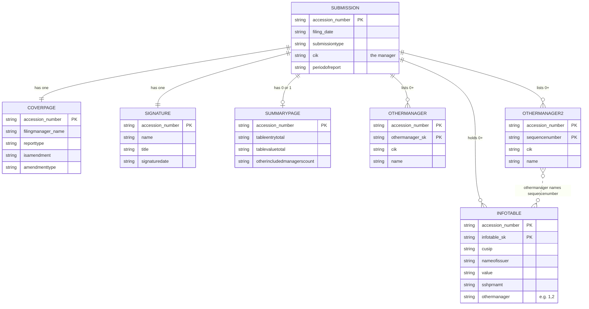
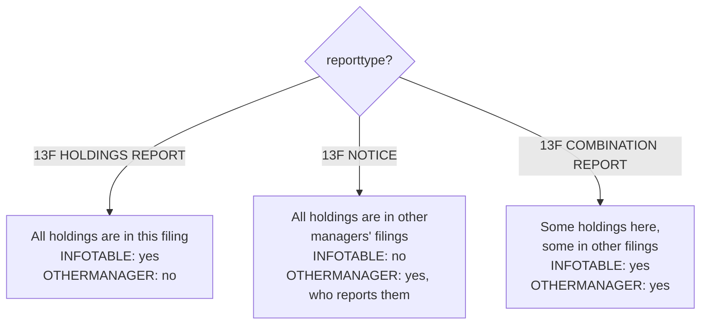
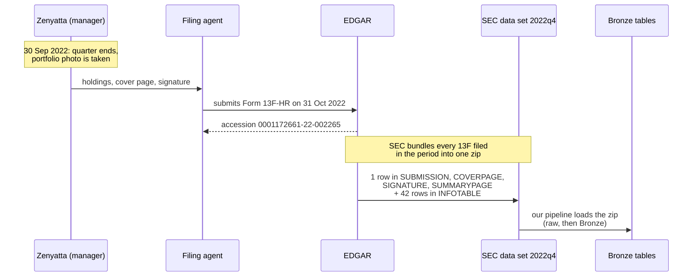

# The 7 SEC 13F tables, explained from scratch

A guide to the data this project loads, written for a developer who knows tables and joins but
not finance. It explains what each of the 7 tables in an SEC Form 13F data set means, what one
row is, which columns matter and how the tables join. It does not explain the code: for that, see
[How the Bronze load works](form13f-bronze-walkthrough.md). Column lists come from
`src/sec_lakehouse/sources/form13f/schemas.py`; the data contract is the
[M1 spec](../specs/m1-bronze-ingestion.md).

**About the examples.** Unless a section says otherwise, the sample rows are real public SEC data,
copied from the small samples in `tests/fixtures/form13f/` (mostly `2022q4`). Columns are trimmed
to fit the page. The people's names and phone numbers in the `SIGNATURE` example are made up.

## First, the finance in five minutes

### What is a 13F?

Big investors in the US must tell the public, every quarter, which stocks they own. The report
they file is called **Form 13F**, after section 13(f) of the law that requires it.

- **Who files.** An **institutional investment manager**: a company that invests other people's
  money (a mutual fund company, a hedge fund, a pension fund, a bank, an insurer). It must file if
  it controls at least $100 million in the kinds of securities the SEC lists, mostly US-listed
  stocks. The manager is also called the **filer**.
- **When.** Within 45 days after each quarter ends. Holdings on 30 September are reported by
  mid-November.
- **What.** A list of every position the manager held on the last day of the quarter: which
  security, how many shares, what they were worth, and who gets to decide and vote on them.
- **Who publishes it.** The **SEC** (Securities and Exchange Commission), the US market regulator.
  Filings go into **EDGAR**, the SEC's public filing system.

Think of it as a quarterly photo of each big investor's portfolio. A 13F does not say when shares
were bought or for how much; it only shows what was held on one day.

### Words you will see everywhere

| Term | Plain meaning | Example |
| --- | --- | --- |
| **Security** | Something you can own and trade: a share of stock, a bond, an option. | One share of Apple |
| **Issuer** | The company that created the security. | Apple Inc. issues Apple shares |
| **Holding** / **position** | How much of one security a manager owns. | 100,000 shares of AMD |
| **Period of report** | The quarter-end date the photo was taken. | `30-SEP-2022` |
| **CIK** | Central Index Key: the SEC's ID for a company or person, 10 digits with leading zeros. Think "user id". | `0001887163` |
| **Accession number** | The ID of one filing, unique across all of EDGAR. Think "order id". | `0001172661-22-002265` |
| **CUSIP** | A 9-character ID for a security in North America. Think "product SKU". | `007903107` = AMD common stock |
| **Amendment** | A later filing that fixes or adds to an earlier one. | `13F-HR/A` |

Two of these hide traps:

- **An accession number is not the manager's CIK.** It is
  `<CIK of whoever submitted>-<2-digit year>-<sequence>`. A manager often pays a *filing agent* to
  submit for it, so the first part can be the agent's CIK. In the example above, the filing
  `0001172661-22-002265` belongs to the manager with CIK `0001887163`. Always take the manager
  from the `cik` column, never from the accession number.
- **A CUSIP names a security, not a company.** Apple's common shares have one CUSIP; an Apple bond
  has another. Many companies have more than one class of shares, each with its own CUSIP.

## Where the tables come from

The SEC turns every 13F filed in a period into one downloadable zip, a **data set**. Inside are 7
tab-separated text files, one per table. Bronze loads each file as a Delta table
(`bronze.form13f_<name>`) with every value kept as text, exactly as the SEC wrote it.



The paper form has parts, and each part became a table:

| Part of the form | Table | One row is ... | Rows per filing |
| --- | --- | --- | --- |
| The envelope (EDGAR's record of the filing) | `SUBMISSION` | one filing | exactly 1 |
| Cover page: who is filing, for which quarter | `COVERPAGE` | one filing | exactly 1 |
| Cover page: other managers who report for this one | `OTHERMANAGER` | one other manager | 0 or more |
| Signature block | `SIGNATURE` | one filing | exactly 1 |
| Summary page: totals | `SUMMARYPAGE` | one filing | 0 or 1 |
| Summary page: other managers included in this report | `OTHERMANAGER2` | one included manager | 0 or more |
| Information table: the holdings | `INFOTABLE` | one holding line | 0 to tens of thousands |

Every table has an `accession_number` column, and that is the join key between all of them.
Bronze also adds 5 columns starting with `_` (`_dataset`, `_source_file`, ...) that say where a
row came from; the Bronze walkthrough explains them, and this guide leaves them out of the
examples.

## How the tables join



Rules of thumb:

- **Join on `accession_number`, inside one data set.** The same filing can appear in two SEC
  zips; the Bronze keys are unique per `_dataset`, so add `_dataset` to the join in Bronze. Silver
  keeps one copy per filing, so there the accession number alone is enough.
- **`SUBMISSION` is the parent.** Every other table's rows should have a matching `SUBMISSION`
  row. Bronze counts the ones that don't (check DQ6) but still loads them.
- **The one odd join.** `INFOTABLE.othermanager` is a text list such as `1,2`. Each number is a
  `sequencenumber` in `OTHERMANAGER2` for the same filing. To join, split the list first.

## The tables, one by one

### 1. SUBMISSION: the envelope

**In plain words:** EDGAR's record that a filing arrived: what kind of form it is, who it is for
and which quarter it covers. Start every query here.

**One row =** one filing. **Key:** `accession_number`.

| Column | Meaning |
| --- | --- |
| `accession_number` | The filing's ID. |
| `filing_date` | The day the filing reached the SEC, as `DD-MON-YYYY`. |
| `submissiontype` | The form type (below). |
| `cik` | The manager the filing is about. Use this, not the accession number, to find the manager. |
| `periodofreport` | The quarter-end date the holdings are for. |

The four form types you will meet:

| `submissiontype` | Means |
| --- | --- |
| `13F-HR` | **Holdings report**: the normal filing with a list of holdings. |
| `13F-HR/A` | An **amendment** to a holdings report (`/A` = amendment). |
| `13F-NT` | **Notice**: "I am a 13F manager, but my holdings are reported in someone else's filing." No holdings list. |
| `13F-NT/A` | An amendment to a notice. |

```text
accession_number       filing_date   submissiontype  cik         periodofreport
0001172661-22-002265   31-OCT-2022   13F-HR          0001887163  30-SEP-2022
0001172661-22-002264   31-OCT-2022   13F-NT          0001833567  30-SEP-2022
0001085146-22-003667   31-OCT-2022   13F-HR/A        0001710666  30-JUN-2022
```

Look at the third row: filed in October 2022 but for the **June** quarter. Amendments can arrive
months or years late, in whatever data set covers the day they were filed. So "the data set for
2022q4" is not the same as "holdings on 31 December 2022".

### 2. COVERPAGE: who is filing, and what kind of report

**In plain words:** the first page of the form. It names the manager and their address, says
whether this filing amends an earlier one, and says what kind of report it is.

**One row =** one filing. **Key:** `accession_number`.

| Column | Meaning |
| --- | --- |
| `reportcalendarorquarter` | The quarter end again, as written on the form. |
| `filingmanager_name`, `filingmanager_street1` ... `filingmanager_zipcode` | The manager's name and address. |
| `reporttype` | `13F HOLDINGS REPORT`, `13F NOTICE` or `13F COMBINATION REPORT` (below). |
| `isamendment` | `Y` if this filing amends an earlier one. Often blank in real data. |
| `amendmentno` | Which amendment this is: 1, 2, ... |
| `amendmenttype` | `RESTATEMENT` (this replaces the whole earlier report) or `NEW HOLDINGS` (this adds holdings that were left out). |
| `confdeniedexpired`, `datedeniedexpired`, `datereported`, `reasonfornonconfidentiality` | About **confidential treatment** (see below). Mostly blank. |
| `form13ffilenumber` | The manager's 13F file number from the SEC, like `028-21557`. Another manager ID. |
| `crdnumber`, `secfilenumber` | More IDs: CRD is the broker and adviser registry's number, the SEC file number comes from other SEC registrations. Often blank. |
| `provideinfoforinstruction5`, `additionalinformation` | A Y/N box and free text for extra notes from the manager. |

The three report types matter, because they tell you which other tables have rows:



```text
accession_number       filingmanager_name                     city      reporttype           isamendment  amendmentno  amendmenttype
0001172661-22-002265   Zenyatta Capital Management LP         Fairfield 13F HOLDINGS REPORT  N
0001172661-22-002264   Volterra Technologies LP               New York  13F NOTICE           N
0001085146-22-003667   Leicht Financial Planning & Wealth ... PARSIPPANY 13F HOLDINGS REPORT  Y            1            RESTATEMENT
```

**Amendments, in one example.** Say a manager files a `13F-HR` for June with 20 holdings, then
spots a mistake. If they file a `13F-HR/A` marked `RESTATEMENT`, the new list replaces the old
one completely: use only the amendment. If they mark it `NEW HOLDINGS`, it lists only holdings
that were missing: add it to the original. Silver resolves this ([ADR-004](../adr/004-amendment-resolution-in-silver.md));
Bronze just keeps both filings.

**Confidential treatment.** A manager can ask the SEC to keep some holdings secret for a while,
for example while it is still buying a stock and does not want others to copy it. Those holdings
are left out of the normal report. When the secrecy ends (it expires, or the SEC says no), the
manager files a `NEW HOLDINGS` amendment that reveals them, with `confdeniedexpired = Y`.

### 3. OTHERMANAGER: who reports holdings for this manager

**In plain words:** on a notice or combination report, the list of *other* managers whose filings
contain this manager's holdings. Big groups often have one company file for the whole family.

**One row =** one other manager named on the cover page. **Key:**
`accession_number, othermanager_sk`.

| Column | Meaning |
| --- | --- |
| `othermanager_sk` | A row ID the SEC made up for this line. It has no meaning of its own. |
| `cik`, `form13ffilenumber`, `crdnumber`, `secfilenumber` | IDs of the other manager. Any of them can be blank. |
| `name` | The other manager's name, as typed by the filer. |

```text
accession_number       othermanager_sk  cik         form13ffilenumber  name
0001172661-22-002264   138628           0001103882  028-05431          Paloma Partners Management Co
```

Read it with the `COVERPAGE` row above: Volterra filed a **notice**, and this row says "look for
Volterra's holdings in Paloma Partners' filing".

### 4. SIGNATURE: who signed

**In plain words:** the person at the manager who signed the form, and when. Useful for audits,
rarely for analysis.

**One row =** one filing. **Key:** `accession_number`.

| Column | Meaning |
| --- | --- |
| `name`, `title`, `phone` | The signer. |
| `signature` | What they typed as a signature, often `/s/ Their Name` (the legal way to sign electronically). |
| `city`, `stateorcountry` | Where they signed. |
| `signaturedate` | When they signed. |

```text
accession_number       name      title                     phone         signature     city       stateorcountry  signaturedate
0001172661-22-002265   Jane Doe  Chief Financial Officer   555-010-0001  /s/ Jane Doe  Fairfield  CT              31-OCT-2022
```

(Signer name and phone made up; the rest is from the real row.)

### 5. SUMMARYPAGE: the totals

**In plain words:** the form's summary page. It says how many holding lines the report has, what
they add up to in dollars, and how many other managers' holdings are included. Notices have no
summary page.

**One row =** one filing. **Key:** `accession_number`.

| Column | Meaning |
| --- | --- |
| `tableentrytotal` | Number of lines in the information table. Should match the `INFOTABLE` row count. |
| `tablevaluetotal` | Sum of the `value` column. **Same unit trap as `value`** (see INFOTABLE). |
| `otherincludedmanagerscount` | How many managers are listed in `OTHERMANAGER2`. |
| `isconfidentialomitted` | `Y` if some holdings were left out under confidential treatment. |

```text
accession_number       otherincludedmanagerscount  tableentrytotal  tablevaluetotal  isconfidentialomitted
0001172661-22-002265   0                           42               172242
0001803536-22-000004   3                           114              178715           N
```

Zenyatta's report has 42 holding lines worth 172,242 **thousand** dollars, about $172 million.
These totals are what the filer typed, so they make a good cross-check of the holdings: if
`count(INFOTABLE)` or `sum(value)` disagrees, something is off in the data or in our load.

### 6. OTHERMANAGER2: other managers included in this report

**In plain words:** the opposite of `OTHERMANAGER`. This is the list of other managers whose
holdings are **inside this** filing, each with a small number so holding lines can point at them.

**One row =** one included manager. **Key:** `accession_number, sequencenumber`, but see the warning.

| Column | Meaning |
| --- | --- |
| `sequencenumber` | The number the filer gave this manager: 1, 2, 3 ... Holding lines refer to it. |
| `cik`, `form13ffilenumber`, `crdnumber`, `secfilenumber`, `name` | Who the manager is. IDs can be blank. |

```text
accession_number       sequencenumber  cik         form13ffilenumber  name
0001803536-22-000004   1               0001027817  028-05936          ATLANTA CAPITAL MANAGEMENT CO L L C
0001803536-22-000004   2               0001407543  028-13411          ENVESTNET ASSET MANAGEMENT INC
0001803536-22-000004   3                                              Legg Mason Private Portfolio Group, LLC
```

Cadent Capital Advisors' report includes holdings it manages together with these three, and its
summary page says `otherincludedmanagerscount = 3`.

**Warning: the key is not always unique.** Real filings sometimes reuse a sequence number for two
different managers. The Bronze check only warns about this table for that reason.

**`OTHERMANAGER` vs `OTHERMANAGER2`**, since everyone mixes them up:

| | `OTHERMANAGER` | `OTHERMANAGER2` |
| --- | --- | --- |
| Part of the form | Cover page | Summary page |
| Question it answers | "Who reports **my** holdings?" | "Whose holdings are **in this** report?" |
| Typical filing | Notice or combination report | Holdings report from a group |
| Referenced by INFOTABLE? | No | Yes, by `sequencenumber` |

### 7. INFOTABLE: the holdings

**In plain words:** the reason this project exists. The information table lists each position:
which security, how much of it, what it was worth, and who controls it. Almost all the rows in a
data set are here: millions per quarter.

**One row =** one holding line. A manager can split one security over several lines, for example
one line per co-manager or per type of discretion, so one CUSIP can appear more than once in a
filing. **Key:** `accession_number, infotable_sk`.

| Column | Meaning |
| --- | --- |
| `infotable_sk` | A row ID the SEC made up. No meaning of its own. |
| `nameofissuer` | The company behind the security, as typed by the filer: `APPLE INC`, `Apple Inc`, `Amazoncom Inc` ... |
| `titleofclass` | Which kind of security: `COM` (common stock), `CL A` (class A shares), `SPONSORED ADS` (a foreign company's shares traded in the US) ... Free text. |
| `cusip` | The security's 9-character ID. **The best key for "which security"**, far better than the name. |
| `figi` | Another security ID (Financial Instrument Global Identifier). Optional and usually blank. |
| `value` | What the position was worth on the period date, in dollars or **thousands** of dollars (below). |
| `sshprnamt` | How much is held: number of shares, or for bonds the principal amount in dollars. |
| `sshprnamttype` | `SH` = shares, `PRN` = principal amount (a bond's face value). |
| `putcall` | Blank for owning the security itself. `Put` or `Call` if the line is an **option** (below). |
| `investmentdiscretion` | Who decides to buy or sell: `SOLE`, `DFND` or `OTR` (below). |
| `othermanager` | For shared positions, which `OTHERMANAGER2` sequence numbers share it, as a list like `1,2`. |
| `voting_auth_sole`, `voting_auth_shared`, `voting_auth_none` | How many of the shares the manager votes alone, votes with others, or does not vote. |

```text
accession_number       nameofissuer                 titleofclass   cusip      value  sshprnamt  sshprnamttype  putcall  investmentdiscretion  othermanager  voting_auth_sole  voting_auth_shared  voting_auth_none
0001172661-22-002265   ADVANCED MICRO DEVICES INC   COM            007903107  6336   100000     SH                      SOLE                                100000            0                   0
0001172661-22-002265   ALIBABA GROUP HLDG LTD       SPONSORED ADS  01609W102  400    5000       SH                      SOLE                                5000              0                   0
0001803536-22-000004   RPM INTL INC                 COM            749685103  283    3395       SH                      DFND                  1,2           0                 0                   3395
0001803536-22-000004   ROCKWELL AUTOMATION INC      COM            773903109  341    1584       SH                      SOLE                                0                 0                   1584
0001722053-22-000006   Amazoncom Inc                Ordinary Shares 023135106  3545   28400      PRN            Call     SOLE                                28400             0                   0
```

Now the columns that need a real explanation.

**`value` changed units in 2023.** Before 2023 the form asked for value in thousands of dollars;
from January 2023 it asks for dollars. In this project the switch goes by filing date: filed
before 2023-01-03 means thousands, from then on means dollars (see the
[M1 spec](../specs/m1-bronze-ingestion.md) and the `value_unit` column in Silver). Two real lines
show why it matters:

| Filing | Line | `value` | Unit | Dollars | Price per share |
| --- | --- | --- | --- | --- | --- |
| Filed Oct 2022 | AMD, 100,000 shares | `6336` | thousands | $6,336,000 | about $63 |
| Filed Jul 2026 | Microsoft, 14,219 shares | `5304131` | dollars | $5,304,131 | about $373 |

Read the 2022 number as dollars and AMD looks like it cost 6 cents a share. Mixing the two units in
one sum is the classic 13F bug.

**Shares vs value.** `sshprnamt` is *how many*; `value` is *how much money*. A manager can hold
fewer shares of an expensive stock and more of a cheap one at the same value, so compare managers
by value and track changes in one stock by shares (prices move, share counts only move when the
manager trades).

**Puts and calls (options).** An **option** is a contract that gives the right to buy (**call**) or
sell (**put**) a stock at a fixed price later. A call bets the price goes up, a put that it goes
down. When `putcall` is set, the line is the option, not the stock, and the amount and value
describe the shares the option covers. Never add put or call lines into "how many shares does this
manager own".

**Investment discretion: who decides to buy or sell.**

| Value | Means |
| --- | --- |
| `SOLE` | This manager alone decides. |
| `DFND` | Shared-defined: decided together with managers named in `othermanager`. |
| `OTR` | Shared-other: shared in some other way. |

**Voting authority: who votes.** Shareholders vote at company meetings (electing the board,
approving mergers). The three `voting_auth_*` columns split the shares by who casts those votes.
They usually add up to `sshprnamt`. The Rockwell line shows that deciding and voting are
separate: Cadent alone decides to buy or sell (`SOLE`), but votes none of the 1,584 shares,
because its clients keep the vote.

**Real data is messy.** The Amazon line above says `PRN` (bond principal) for what are clearly
shares and options. Names are typed by hand (`Amazoncom Inc`), some names are padded with
spaces, and the same company is spelled many ways. Bronze keeps all of it unchanged; cleaning is
Silver's job, and matching names and CUSIPs to real entities is M3's.

## Following one filing end to end

Let's follow Zenyatta Capital Management's report for the quarter ending 30 September 2022, from
the fixture sample `2022q4`.



1. **`SUBMISSION`** says filing `0001172661-22-002265` is a `13F-HR` filed on `31-OCT-2022` for
   period `30-SEP-2022`, by manager CIK `0001887163`. The accession number starts with
   `0001172661`, a different CIK: a filing agent submitted it.
2. **`COVERPAGE`** names the manager, Zenyatta Capital Management LP of Fairfield, CT, and says
   `13F HOLDINGS REPORT`, not an amendment. So we expect holdings and no `OTHERMANAGER` rows.
3. **`OTHERMANAGER`** has no rows for this accession number, as expected.
4. **`SIGNATURE`** has one row: the CFO signed on 31 October.
5. **`SUMMARYPAGE`** says 42 holding lines, total value 172,242, and 0 other included managers.
   It was filed in 2022, so the unit is thousands: about $172 million.
6. **`OTHERMANAGER2`** has no rows, matching the count of 0.
7. **`INFOTABLE`** has the 42 lines (the fixture keeps the first 20). AMD, Air Products, Alcoa,
   Alibaba, Amazon ... all `SH`, all `SOLE`, all voted by Zenyatta alone.

The same check as SQL, which works in Bronze (all strings, so cast before summing):

```sql
select s.accession_number,
       c.filingmanager_name,
       s.periodofreport,
       p.tableentrytotal,
       count(i.infotable_sk)                 as lines_found,
       p.tablevaluetotal,
       sum(cast(i.value as bigint))          as value_found
from bronze.form13f_submission s
join bronze.form13f_coverpage c
  on c.accession_number = s.accession_number and c._dataset = s._dataset
left join bronze.form13f_summarypage p
  on p.accession_number = s.accession_number and p._dataset = s._dataset
left join bronze.form13f_infotable i
  on i.accession_number = s.accession_number and i._dataset = s._dataset
where s._dataset = '2022q4'
  and s.accession_number = '0001172661-22-002265'
group by s.accession_number, c.filingmanager_name, s.periodofreport,
         p.tableentrytotal, p.tablevaluetotal
```

In the full data set `lines_found` should be 42 and `value_found` 172242; in the fixture sample
you get 20 lines, because it is a cut.

## Where the data goes next

- **Silver (M2)** types the values, picks one copy of each filing and resolves amendments. Its
  first table, `silver.form13f_filing`, merges `SUBMISSION`, `COVERPAGE` and `SUMMARYPAGE` into
  one row per filing ([Silver walkthrough](form13f-silver-filing-walkthrough.md)).
- **Entity resolution (M3)** decides which CIKs, names and CUSIPs are the same real manager or
  security, across years of typos.
- **Gold (M4)** answers questions like "who were the biggest holders of AMD at the end of 2022?".

## Glossary

| Term | Meaning |
| --- | --- |
| 13F (Form 13F) | The quarterly holdings report big US investment managers must file. |
| Accession number | The unique ID of one filing on EDGAR, `<submitter CIK>-<yy>-<sequence>`. |
| Amendment (`/A`) | A later filing that fixes (`RESTATEMENT`) or adds to (`NEW HOLDINGS`) an earlier one. |
| Call | An option giving the right to *buy* a stock at a set price; a bet the price rises. |
| CIK | Central Index Key: the SEC's 10-digit ID for a company or person. |
| Combination report | A 13F that lists some holdings itself and points to other filings for the rest. |
| Confidential treatment | SEC permission to leave some holdings out of a report for a while. |
| CRD number | An ID from the registry of brokers and investment advisers. |
| CUSIP | The 9-character ID of a security (not of a company). |
| Data set | The SEC's zip of all 13F filings in a period; one Dagster partition here. |
| EDGAR | The SEC's public system where filings are submitted and published. |
| FIGI | Financial Instrument Global Identifier, an alternative security ID; usually blank here. |
| Filer | The manager a 13F is about (identified by `cik`). |
| Filing agent | A company paid to submit filings for others; its CIK can start the accession number. |
| Holding / position | How much of one security a manager owns. |
| Holdings report | A 13F that lists all of the manager's holdings itself (`13F-HR`). |
| Institutional investment manager | A firm investing others' money; files a 13F above $100 million in listed securities. |
| Investment discretion | Who decides to buy or sell: `SOLE`, `DFND` (shared-defined), `OTR` (shared-other). |
| Issuer | The company that created a security. |
| Notice | A 13F that lists no holdings, only who reports them (`13F-NT`). |
| Option | A contract to buy or sell a stock later at a fixed price: a put or a call. |
| Period of report | The quarter-end date a 13F describes. |
| Principal amount (`PRN`) | A bond's face value in dollars, used instead of a share count. |
| Put | An option giving the right to *sell* a stock at a set price; a bet the price falls. |
| SEC | Securities and Exchange Commission, the US market regulator. |
| Security | A tradable financial asset: a share, a bond, an option. |
| Shares (`SH`) | Units of ownership in a company. |
| Value | Market value of a position on the period date: thousands of dollars before 2023, dollars after. |
| Voting authority | Who casts the votes of shares at company meetings: sole, shared or none. |
