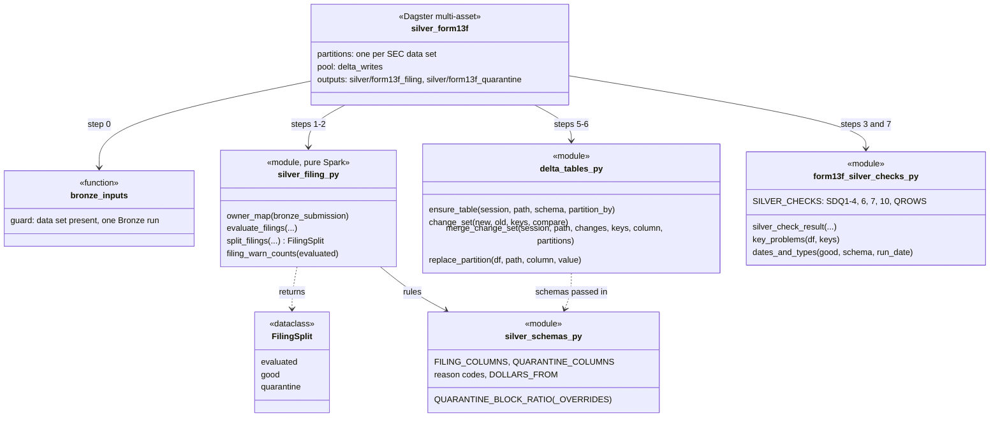
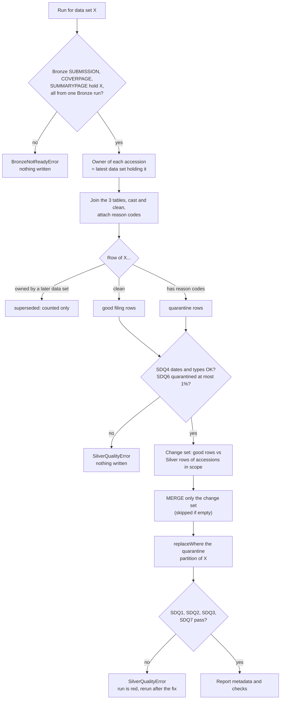
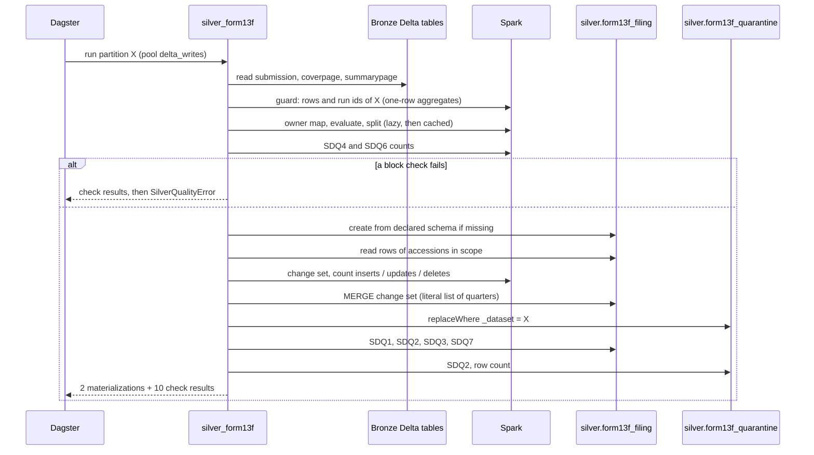
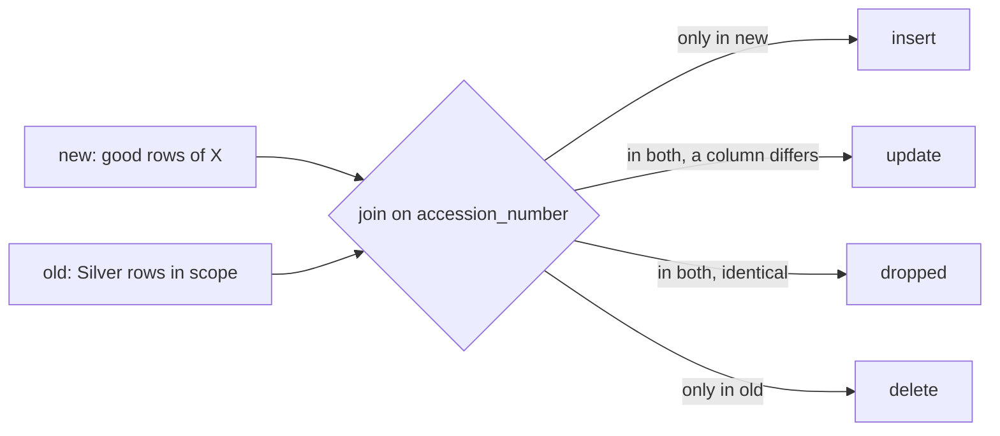
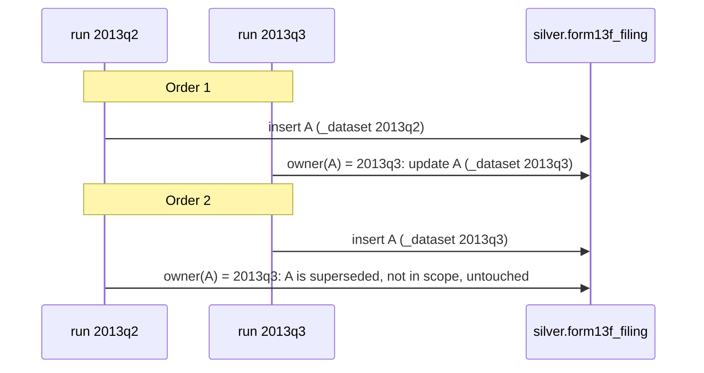

# How Silver filings and quarantine work (M2 slice S1)

A walkthrough of the `silver_form13f` asset, written for someone new to Dagster, Spark and Delta
Lake. It explains the first Silver slice: the typed filing table, the quarantine table and the
change-set `MERGE` that keeps reruns cheap and safe. Rules: [M2 spec](../specs/m2-silver.md);
design: [ADR-005](../adr/005-silver-keys-layout-and-write-strategy.md); how to run it:
[runbook](../runbooks/form13f-silver.md). It builds on
[How the Bronze load works](form13f-bronze-walkthrough.md).

## The big picture

Bronze keeps every 13F value as SEC wrote it: all strings, `""` for empty, dates like
`31-MAY-2013`. That is safe but awkward to query. Silver is the cleaned copy that later layers can
trust.

This slice turns three Bronze tables (`SUBMISSION`, `COVERPAGE`, `SUMMARYPAGE`) into one typed
table with **one row per filing**:

- **`silver.form13f_filing`**: dates are real dates, counts are integers, Y/N flags are booleans,
  text is trimmed and `""` becomes `null`. It also says which unit the filing's dollar amounts use
  (`value_unit`): thousands before 2023-01-03, dollars from then on.
- **`silver.form13f_quarantine`**: every Bronze row that broke a rule (a date that isn't a date,
  an unknown form type, ...) lands here instead of disappearing, with the reasons and the original
  row as JSON. Nothing is ever silently dropped.

Three ideas carry the design:

1. **One run handles one data set**, the same Dagster partitions as Bronze (`2013q2` ...
   `2026-06_2026-08`). A Silver run reads only Bronze, never SEC.
2. **The latest data set wins.** The same filing (accession number) can appear in two SEC zips.
   Silver keeps one row, the copy from the latest data set, whichever order the runs happen in.
3. **Only real changes are written.** A rerun with nothing new in Bronze writes nothing to the
   filing table. Rows of other data sets are never touched.

## The building blocks



The cleaning rules in `silver_filing.py` are plain functions from DataFrames to DataFrames, with
no reading or writing. That is what lets the tests feed them small made-up data. `delta_tables.py`
knows nothing about 13F; it is the generic "write only what changed" machinery that the holding
table will reuse in slice S2.

## Key terms in two minutes

- **Dagster partition vs Delta partition.** A Dagster partition is a slice of work, here one SEC
  data set. A Delta partition is a folder inside a table, one per value of a column
  (`period_of_report=2024-12-31/`). The filing table is split into folders by **quarter**, so a
  query for one quarter reads one folder (this is **pruning**). One data set run can touch several
  quarter folders, because amendments for old quarters arrive late.
- **Owner.** For each accession number, the latest data set whose SUBMISSION holds it. Data set
  keys sort in time order as strings (`2013q2` < `2023q4` < `2024-01_2024-02`), so the owner is
  just `max(_dataset)`.
- **Superseded.** A row of data set X whose accession is owned by a later data set. It is neither
  written nor quarantined, only counted, because a newer copy exists.
- **`MERGE`.** One atomic Delta command that compares incoming rows with the table on a key, and
  updates, inserts or deletes them.
- **Change set.** The rows that really must change: new ones (insert), different ones (update),
  and ones that left Bronze (delete). Identical rows are dropped before the `MERGE`.
- **`replaceWhere`.** Overwrite only the rows matching a condition, in one commit. Quarantine uses
  it per data set: a rerun replaces that data set's quarantine rows, so a fixed row leaves.

## One run, start to finish



Two kinds of failure, on purpose:

- **Before writing** (guard, SDQ4, SDQ6): the data set is wrong or Bronze isn't ready. Silver is
  left exactly as it was.
- **After writing** (SDQ1, SDQ2, SDQ3, SDQ7): these can only be checked on the table itself. If
  one fails, the run shows red, and a rerun after the fix repairs the data set, because the
  change set always moves Silver towards "exactly the clean Bronze rows of X".

## Who talks to whom



## Walking through the code

### 0. The guard: is Bronze ready? (`bronze_inputs` in `assets/form13f_silver.py`)

Bronze writes its 7 tables one after the other, with no transaction across tables (ADR-002). If a
Bronze run died halfway, COVERPAGE could hold a newer load of X than SUBMISSION. The guard reads,
for each input table, the row count and the set of `_run_id` values for X. It stops the run if a
table has no rows for X, or if the tables don't all come from one Bronze run.

### 1. Who owns each accession (`owner_map`)

```python
bronze_submission.groupBy("accession_number").agg(F.max("_dataset").alias("owner"))
```

This reads two columns of the whole Bronze SUBMISSION table (about a million short rows), the one
Bronze read that isn't limited to X. The result stays in Spark; nothing is collected.

### 2. Cast, clean and attach reasons (`evaluate_filings`)

The three Bronze tables of X are joined on `accession_number`. Each table's raw columns are kept
as a struct (`sub`, `cov`, `sum`), so the original strings stay at hand for the quarantine's
`raw_row` and for the warning counts.

Small helpers do the cleaning, all Spark built-ins (no Python UDFs, which would be slow):

| Helper | Does | Example |
| --- | --- | --- |
| `blank_to_null` | trim, then `""` to null | `"AERCAP HOLDINGS NV "` to `"AERCAP HOLDINGS NV"` |
| `parse_date` | checks the shape `DD-MON-YYYY`, then `to_date` | `31-MAY-2013` to 2013-05-31, `31-FEB-2013` to null |
| `bad_unsigned` | present but not 1 to N digits | `-1`, `12.5`, a 17-digit value |
| `to_flag` | `Y` true, `N` false, else null | `X` to null (and counted by SDQ10) |

Why check the shape before `to_date`? With Spark's default parser settings, some odd strings make
`to_date` throw an error instead of returning null. A regex first keeps one strange value from
crashing the whole run.

Why check digits before casting? Spark runs with ANSI mode off, so casting an overflowing number
to `int` silently gives null. The regex catches it and the row gets `BAD_INTEGER` instead.

The value unit is decided once, on the filing, **by filing date**:

```python
value_unit = F.when(filing_date < F.lit(DOLLARS_FROM), "THOUSANDS").when(
    filing_date.isNotNull(), "DOLLARS"
)
```

So an amendment filed in 2024 for a 2022 quarter is in dollars. `table_value_total_usd` is the
reported total times 1000 for `THOUSANDS`, cast back to `decimal(20,0)` (16 digits times 1000
still fits in 20).

Each rule is a `(code, condition, detail)` triple. The reason codes become one array per row:

```python
F.array_distinct(F.array_compact(F.array(*(F.when(cond, F.lit(code)) for code, cond, _ in failed))))
```

`F.when` without `otherwise` gives null when the rule passes, `array_compact` drops the nulls, and
`array_distinct` keeps one `BAD_DATE` even if two dates are bad. The codes always come in the same
order: `BAD_DATE`, `BAD_PERIOD`, `BAD_SUBMISSION_TYPE`, `BAD_INTEGER`, `NO_FILING`.

| Code | When |
| --- | --- |
| `BAD_DATE` | `filing_date`, `period_of_report` or `report_calendar_or_quarter` missing or not a real date |
| `BAD_PERIOD` | the period is not a quarter end, or is after the filing date |
| `BAD_SUBMISSION_TYPE` | not `13F-HR`, `13F-HR/A`, `13F-NT` or `13F-NT/A` |
| `BAD_INTEGER` | `amendmentno` or a SUMMARYPAGE count or total is not a whole number that fits |
| `NO_FILING` | a COVERPAGE or SUMMARYPAGE row whose accession has no SUBMISSION row in X |

A bad optional value (an unknown Y/N flag, a bad `datereported`) does **not** quarantine the
filing: it becomes null and SDQ10 counts it.

### 3. Split three ways (`split_filings`)

Every row of X ends up in exactly one bucket: superseded (owned by a later data set), quarantine
(has reason codes), or good. That is what makes the conservation check SDQ3 possible:
`Bronze rows = Silver rows + quarantined + superseded`.

### 4. Block checks before writing

- **SDQ4**: the good rows match the declared schema, `filing_date` is between 2013-05-01 and
  today, and the period is not after the filing date.
- **SDQ6**: the share of quarantined filings. Above 0 it warns; above 1% it blocks the data set.
  A data set with a known reason for more can get a reviewed override in
  `QUARANTINE_BLOCK_RATIO_OVERRIDES` (in code, so the full backfill never needs a manual step).

### 5. The change set and the `MERGE` (`delta_tables.py`)

First the scope: the accessions X owns, plus the ones Silver currently says came from X (so a
filing that disappeared from a re-landed zip can be deleted). The Silver rows of that scope are
`old`, X's good rows are `new`.



"Differs" uses `eqNullSafe` (`<=>` in SQL), so null compared with null counts as equal, and null
compared with a value counts as different. The run columns `_silver_processed_at` and
`_silver_run_id` are left out of the comparison and set only on inserted and updated rows. That is
why a rerun keeps every unchanged row's original run id.

The `MERGE` then applies only those rows:

```text
MERGE INTO silver.form13f_filing t USING changes s
  ON t.period_of_report IN (DATE'2013-03-31', ...) AND t.accession_number = s.accession_number
WHEN MATCHED AND s._op = 'D' THEN DELETE
WHEN MATCHED AND s._op <> 'D' THEN UPDATE SET *
WHEN NOT MATCHED AND s._op <> 'D' THEN INSERT *
```

The literal list of quarters is the important part. It was tested on delta-spark 3.3.3: with a
literal `IN` list, Delta reads only those quarter folders; with `t.period = s.period` alone, it
reads the whole table. The list holds every quarter of the new rows and of the old rows, so if a
re-landed filing changed its period, the update moves the row to its new folder instead of leaving
a duplicate behind. The list is collected to the driver, which is fine: it holds at most about
150 quarter-end dates.

An empty change set skips the `MERGE`, so a no-op rerun doesn't even add a Delta version.

### 6. Quarantine: one partition per data set

All of X's quarantine rows are written with `replaceWhere _dataset = 'X'` in one commit. An empty
frame empties the partition, so after a fix a rerun clears the old rows.

### 7. Checks after writing

SDQ1 (X has Silver rows), SDQ2 (key not null and unique, over the whole filing table, which is
small), SDQ3 (conservation), SDQ7 (every Silver row of X has its Bronze SUBMISSION row); on the
quarantine table, SDQ2 (key unique, every row has reason codes and its raw row) and a row count.
SDQ10's counts are attached as metadata and only warn.

The filing materialization also records `inserted`, `updated`, `deleted`, `quarantined`,
`superseded`, the quarters touched, and two lists that tell the operator what to rerun:
`taken_over_from` (data sets whose rows X replaced with newer copies) and `handed_back_to` (data
sets that hold an accession X just dropped).

## Why the order of runs doesn't matter

Say filing A is in both `2013q2` and `2013q3`.



Both orders end with A's row from `2013q3`. The owner comes from Bronze only, never from Silver or
from run order, so the final table is "for each accession, the clean rows of its owner". This
assumes Bronze is complete before the Silver backfill (spec Q8).

## Safety nets

| Risk | What stops it |
| --- | --- |
| Bronze half loaded | the guard refuses the run, nothing written |
| A systematic format change quarantines everything | SDQ6 blocks above 1%, nothing written |
| Schema drift | tables are created from declared schemas; Delta refuses a mismatched write; SDQ4 compares the frame with the schema |
| Rerun rewrites everything | change set: identical rows are never written |
| Two writers at once | pool `delta_writes` (limit 1), shared with Bronze |
| A row lost between Bronze and Silver | SDQ3 conservation, SDQ7 referential |
| A crash on an odd date string | the shape regex runs before `to_date` |

## Tests

- `tests/test_delta_tables.py`: change set classification (null-safe), a `MERGE` that moves a row
  to a new quarter and leaves other quarters alone, `replaceWhere` with an empty frame.
- `tests/test_form13f_silver_asset.py`, on the three real samples: every filing is clean, the
  schema is the declared one, all block checks pass; the 2022 restatement
  `0001085146-22-003667` and the 2013 notice amendment `0000950123-13-003781` have the expected
  typed values.
- Same file, on hand-made data sets (made-up rows chosen to hit one rule each): the unit boundary
  (2022-12-30 is thousands, 2023-01-03 dollars), the cleaning rules and SDQ10 counts, one row per
  reason code plus an orphan COVERPAGE row, a fix that empties the quarantine, the SDQ6 block, a
  no-op rerun (0 inserts, updates, deletes, run ids kept), a re-land that updates, moves and
  deletes, a shared accession in both run orders, and the half-loaded Bronze guard.

## Glossary

| Term | Meaning |
| --- | --- |
| Accession number | SEC's id of one filing, e.g. `0001085146-22-003667` |
| Amendment | A later filing (`13F-HR/A`) that restates or adds to an earlier report |
| Asset check | A Dagster test attached to a table; **block** fails the run, **warn** records a number |
| Change set | The rows to insert, update or delete, found before writing |
| Data set | One SEC zip, one Dagster partition (`2022q4`, `2026-06_2026-08`) |
| `eqNullSafe` | Equality where null equals null (`<=>` in SQL) |
| Idempotent | Running twice gives the same result as once |
| Owner | The latest data set holding an accession |
| Pruning | Reading only the Delta folders a filter needs |
| Quarantine | Where rows that fail a rule go, with reasons and the raw row |
| Superseded | A row of a data set whose accession a later data set owns |
| `value_unit` | `THOUSANDS` before 2023-01-03, `DOLLARS` from then on, by filing date |
