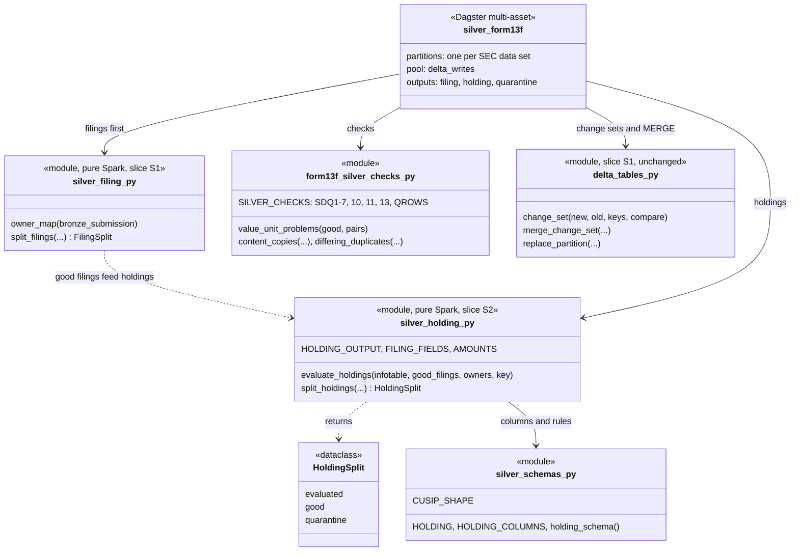
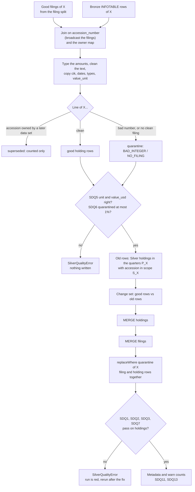
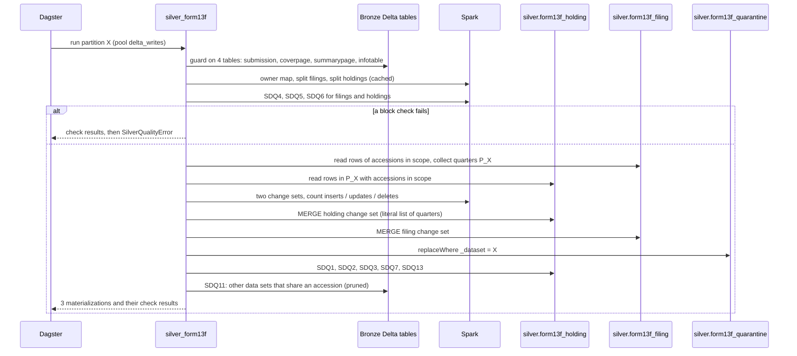

# How Silver holdings work (M2 slice S2)

A walkthrough of the holding table that slice S2 adds to the `silver_form13f` asset, written for
someone new to Dagster, Spark and Delta Lake. Read
[How Silver filings and quarantine work](form13f-silver-filing-walkthrough.md) first: this slice
reuses its owner map, change set and quarantine, and only the new parts are explained in depth
here. Rules: [M2 spec](../specs/m2-silver.md) (`silver.form13f_holding`, "Value-unit
normalization", "Duplicates"); design: [ADR-005](../adr/005-silver-keys-layout-and-write-strategy.md);
how to run it: [runbook](../runbooks/form13f-silver.md).

## The big picture

A 13F filing says "here is what I held at the end of the quarter". The list itself is the
INFOTABLE: one line per position (issuer, CUSIP, market value, number of shares, put or call,
voting authority). In Bronze every one of those values is a string. This slice turns INFOTABLE
into **`silver.form13f_holding`**, one typed row per holding line, keyed by
`(accession_number, infotable_sk)`.

Three things make holdings more than "filings again, but bigger":

1. **The dollar unit changed in 2023.** Filings before 2023-01-03 report `value` in thousands of
   dollars; later ones in dollars. A holding line does not know its own filing date, so it takes
   the unit from its filing. `value_reported` keeps the number as filed, `value_usd` is always
   dollars.
2. **A holding needs a clean filing.** Without one, Silver would not know the unit, the quarter
   or the filer. So a line whose filing is missing or was quarantined goes to quarantine too
   (`NO_FILING`). This is the **cascade**.
3. **Holdings are big.** Hundreds of millions of rows in total, millions per data set. The run
   must read as little of the existing table as it can.

## The building blocks



`delta_tables.py` did not change at all: the change-set `MERGE` from slice S1 was written to be
generic, and the holding table is its second user.

## Key terms in two minutes

- **`infotable_sk`.** SEC's number for one holding line. Together with the accession number it is
  the documented key of INFOTABLE.
- **CUSIP.** The 9-character id of a US or Canadian security (`594918104` is Microsoft). A
  **CINS** is the foreign variant and starts with a letter (`N00985106`); same shape.
- **`SH` vs `PRN`.** `sshprnamt` is a share count when the type is `SH`, and a principal amount in
  dollars when it is `PRN` (bonds). The two can't be added together, so Silver keeps the type next
  to the number.
- **Broadcast join.** When one side of a join is small, Spark copies it to every worker so the
  big side never has to be shuffled across the network. A data set has tens of thousands of
  filings at most, so the filings side is broadcast to the millions of holding lines.
- **Cascade.** A filing that fails a rule takes all its holding lines into quarantine with it.

## One run, the holding part

The filing part of a run is unchanged (see the S1 walkthrough). The holding part slots in after
the filings are split, and its writes come first:



## Who talks to whom



## Walking through the code

### 1. The guard now covers INFOTABLE (`bronze_inputs`)

The step-0 guard of S1 reads `SILVER_SOURCES`, which is now the three filing tables plus
`infotable`. All four must hold the data set and come from one Bronze run; a Bronze load that died
before writing INFOTABLE is refused with "half loaded".

### 2. Typing a holding line (`evaluate_holdings` in `sources/form13f/silver_holding.py`)

The INFOTABLE rows of X are joined to two small frames:

```python
infotable.select("accession_number", "_source_line", F.struct(*INFOTABLE_COLUMNS).alias("it"))
    .join(F.broadcast(filing_fields), "accession_number", "left")
    .join(owners, "accession_number", "left")
```

`filing_fields` is X's good filings with `cik`, `filing_date`, `period_of_report`,
`submission_type`, `amendment_type`, `value_unit`, and a marker column `_has_filing`. After a
left join, a line with no clean filing has `_has_filing` null, which is how `NO_FILING` is found.
The raw INFOTABLE strings stay in the struct `it`, for the quarantine's `raw_row`.

The numbers are checked before they are cast, for the same reason as in S1 (an overflowing cast
silently gives null with ANSI mode off):

| Silver column | Bronze column | Rule |
| --- | --- | --- |
| `infotable_sk` (bigint) | `infotable_sk` | required, 1 to 18 digits |
| `value_reported` (decimal(20,0)) | `value` | required, 1 to 16 digits |
| `shares_or_principal` (decimal(20,0)) | `sshprnamt` | required, 1 to 16 digits |
| `voting_auth_sole`, `_shared`, `_none` | same names | optional (empty is null), 1 to 16 digits |

A required number that is empty, or any number with a sign, a decimal point or too many digits,
is `BAD_INTEGER`. The spec does not say which amounts are required; this slice reads it as "the
key, the value and the share count", because `value_usd` and any position size depend on them,
while voting authority is often left at 0 and an empty one loses nothing.

The dollar amount:

```python
"value_usd": F.when(
    F.col("value_unit") == "THOUSANDS", (value_reported * 1000).cast("decimal(20,0)")
).otherwise(value_reported)
```

`value_unit` came from the filing, so the unit is decided in exactly one place, on the filing, by
filing date. An amendment filed in 2024 for a 2022 quarter is in dollars, and so are its lines.

Text columns are trimmed and `""` becomes null. `cusip`, `sshprnamttype`, `putcall` and
`investmentdiscretion` are also upper-cased (`Call` becomes `CALL`). `othermanager` is kept as it
was filed, apart from trimming (`None`, `1,2`, `01` stay as they are); parsing it is later work.

`cusip_format_ok` is true when the CUSIP is 9 letters or digits. A CUSIP of another shape is
**kept and flagged**, not quarantined: the position is real, only its id is odd. The real
`2013q2` sample shows why: some filers dropped the leading zeros (`1282102  ` for `001282102`).
Padding them back looks easy but would guess; fixing ids is entity resolution (M3).

### 3. Split three ways (`split_holdings`)

Same pattern as filings. A line whose accession a later data set owns is **superseded** (counted,
never written). Ownership is decided per accession, from SUBMISSION only (ADR-005): if the later
copy of a filing has no lines, or gets quarantined there, the earlier lines are still not used.
The filing and its lines always come from the same copy. The rest is either clean (`good`) or has reason codes (`quarantine`, with
`source_table = 'infotable'` and the raw line as JSON). So for every data set:
`Bronze INFOTABLE rows = Silver holding rows + quarantined lines + superseded lines` (SDQ3).

### 4. Block checks before writing

- **SDQ5** (filing and holding): the unit is `THOUSANDS` exactly when the filing date is before
  2023-01-03, and the dollar amount is the reported one times 1000 or 1. `value_unit_problems`
  computes this again from `filing_date`, written separately from the cleaning code on purpose: a
  check that called the same function would agree with any bug in it.
- **SDQ6** now runs for holdings too: more than 1% of the data set's lines in quarantine blocks
  the run, and nothing is written. Note that one quarantined filing cascades all its lines, so a
  single bad filing with 5,000 lines can block a small data set; the error message lists the top
  reason codes, so `NO_FILING` at the top points at the filing side.

### 5. Reading the old holding rows

To build the change set, the run needs the holdings Silver already has for the accessions it is
responsible for (`S_X`, from S1). Two filters:

```python
silver_holdings.where(
    F.col("period_of_report").isin(*periods)  # 1. partition pruning: only quarters P_X
).join(scope, "accession_number", "left_semi")  # 2. exactly the accessions in S_X
```

1. `P_X` comes from the filing table, which is small. It is enough because a holding row is
   always written in the same quarter as its filing row, and the filing row is written last (see
   step 6), so the filing table never forgets a quarter that still holds lines.
2. The semi-join keeps only rows whose accession is in `S_X`.

**A tempting shortcut that was taken out.** The first draft also filtered on `_dataset`, so Delta
could skip files by their `_dataset` min/max statistics. The code review found the hole: if a run
dies after the holding `MERGE` and before the filing `MERGE`, the lines say one data set and their
filing row another, and a later take-over by a third data set would never read those lines. Some
would stay forever with no filing. The test
`test_lines_left_by_a_crash_between_the_two_merges_are_repaired_later` builds exactly that case.
Correct first; if reading whole quarters turns out slow on UAT (the latest data sets touch up to
100 quarters because of late amendments, measured in S1), S4 is where to make it faster.

### 6. Writes: holdings first

```python
if h_ops:
    merge_change_set(session, holding_path, h_changes, HOLDING.keys, "period_of_report", periods)
if f_ops:
    merge_change_set(session, filing_path, f_changes, FILING.keys, "period_of_report", periods)
replace_partition(fsplit.quarantine.unionByName(hsplit.quarantine) ..., quarantine_path, ...)
```

The filing table is the index that says which quarters may hold rows of `S_X`. If a run dies
between the two `MERGE`s, the filing table still lists the old quarters, so the rerun finds every
holding row it has to fix. Writing filings first would lose that.

Filing and holding quarantine rows go into one `replaceWhere` per data set, so the quarantine
partition of X always comes from one run.

### 7. Checks after writing

On the holding table, every read filters on `P_X`:

- **SDQ1**: X has at least one Silver holding row.
- **SDQ2**: no null key part and no duplicate key, over the rows of the accessions in `S_X`. The
  spec says "whole table"; on 200 M rows that is a big shuffle per data set, and this run can
  only have written keys of `S_X`. The whole-table query is part of acceptance (AC13).
- **SDQ3**: conservation, as above.
- **SDQ7**: every holding row of X (`_dataset = X`) has a filing row with the same accession,
  quarter and data set.
- **SDQ13** (warn): lines with `cusip_format_ok = false`.
- **SDQ11** (warn, filing and holding): keys of X that another data set also holds, and how many
  of those copies differ. `duplicate_copies` first asks Bronze SUBMISSION which other data sets
  share an accession with X. Usually none, and the check stops there. Otherwise it hashes the raw
  Bronze columns of the shared rows (`xxhash64`), reading only those data sets' partitions, and
  counts keys with more than one hash. Either way the latest data set wins; SDQ11 only says how
  often the copies disagree.

The holding materialization records `inserted`, `updated`, `deleted`, `quarantined`,
and `superseded`. The quarantine's
`reasons` metadata is now keyed by table and code, such as `infotable:NO_FILING`.

## Safety nets

| Risk | What stops it |
| --- | --- |
| A line in the wrong unit | the unit comes only from the filing; SDQ5 recomputes it before writing |
| A line without a filing (no unit, no quarter) | cascade to quarantine as `NO_FILING`; SDQ7 after writing |
| An overflowing or signed number | digit regex before the cast, `BAD_INTEGER` |
| A bad filing with many lines quietly dropping data | SDQ3 counts every line; SDQ6 blocks above 1% |
| A crash between the two `MERGE`s | holdings first, so later runs still find the old quarters and lines (tested) |
| Two copies of a filing in two zips | the owner rule picks the latest; SDQ11 counts copies that differ |
| An odd CUSIP | kept and flagged (`cusip_format_ok`), counted by SDQ13 |
| Reading the whole holding table every run | quarter pruning to `P_X`, then a semi-join on `S_X` |

## Tests

All in `tests/test_form13f_silver_asset.py`. The hand-made data sets now get one holding line per
filing by default (`line(...)` and the `lines=` argument of `bronze_rows` add more).

- Real samples: all 520 lines land, the declared schema holds, AMD in `2022q4` (6,336 in
  thousands is $6,336,000) and Microsoft in `2026-06_2026-08` (5,304,131 in dollars), the filing
  fields match the parent filing, `Call`/`Put` are upper-cased, and the 8 short CUSIPs of `2013q2`
  are counted by SDQ13.
- Unit boundary: the same value 500 is $500,000 on a filing of 2022-12-30 and $500 on 2023-01-03.
- Holding rules: a CINS is valid, a 5-character CUSIP is kept and flagged, an empty optional
  voting count is null, and one line per `BAD_INTEGER` case (empty value, 17 digits, a bad key,
  two bad columns at once) plus an orphan line (`NO_FILING`).
- Cascade: every line of a quarantined filing is in quarantine as `NO_FILING`.
- SDQ6 blocks on holdings alone and writes nothing.
- Change sets: a rerun writes nothing; a re-land that changes one line's value, removes one and
  adds one gives 1 insert, 1 update, 1 delete, and the untouched line keeps its run id; a filing
  moved to another quarter moves its lines too.
- Duplicates: a shared accession ends with the latest data set's lines in both run orders; SDQ11
  counts the differing copies, and identical copies are shared but not differing; a later take-over
  rewrites the lines' `_dataset`; lines left behind by a run that died between the two `MERGE`s
  are found and replaced by a later take-over.
- AC16: every Silver table declares its checks with the spec's blocking flags.

## Glossary

| Term | Meaning |
| --- | --- |
| Broadcast join | Spark copies the small side of a join to every worker, so the big side is not shuffled |
| Cascade | A quarantined filing sends all its holding lines to quarantine |
| CUSIP / CINS | 9-character security id; CINS is the foreign variant, starting with a letter |
| `infotable_sk` | SEC's id of one holding line inside a filing |
| `P_X` | The quarters data set X may touch: its filings' quarters plus those of the rows it replaces |
| `S_X` | The accessions data set X is responsible for: those it owns plus those Silver says came from it |
| `SH` / `PRN` | Shares, or principal amount in dollars (bonds); never added together |
| `value_reported` / `value_usd` | The market value as filed, and the same in dollars |
| `xxhash64` | A fast 64-bit hash, used to compare two copies of a row without comparing every column |
